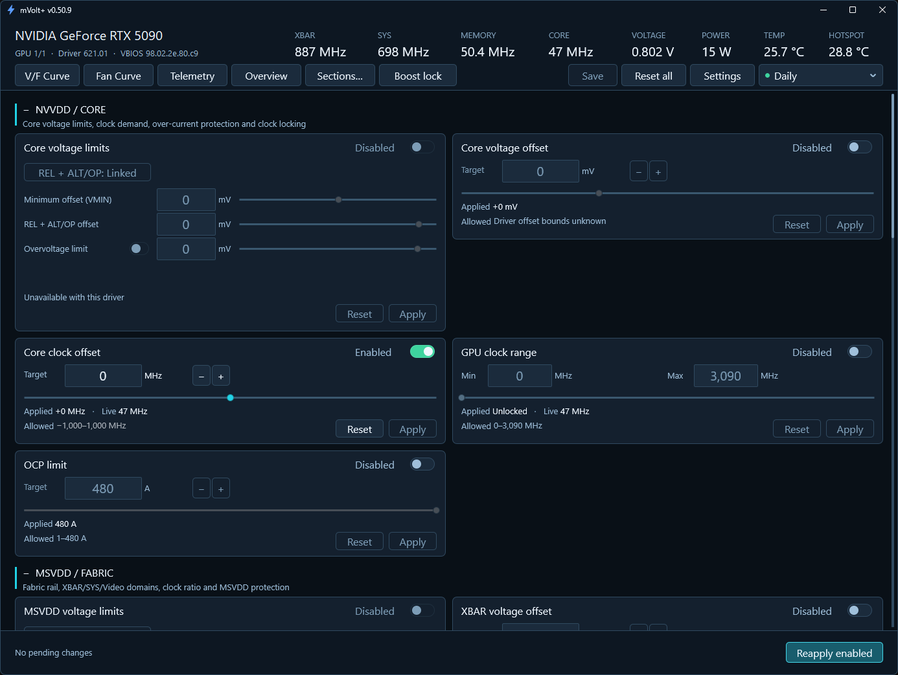
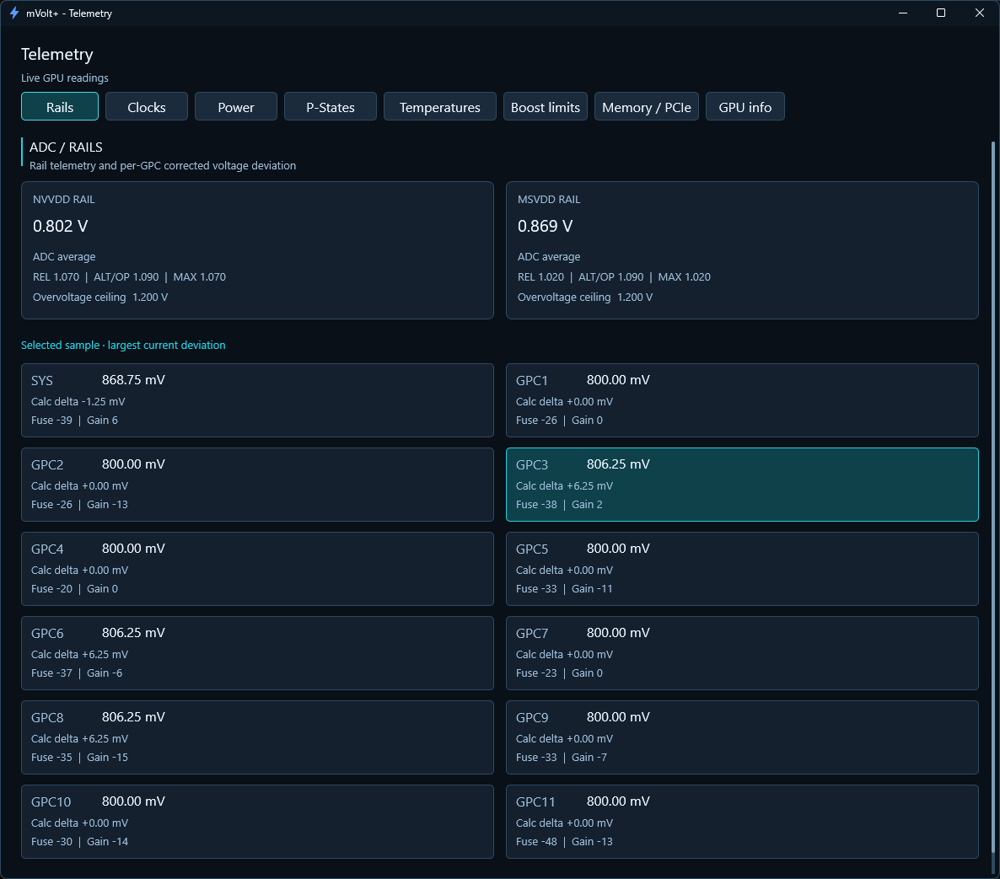

# mVolt+

mVolt+ is a Windows utility for NVIDIA GPU tuning and monitoring. It supports
core and fabric voltage limits, clock offsets, power limits, V/F and fan curves,
saved profiles and software BIOS override.

RTX 50 series is the primary target. Support for earlier GeForce generations is
experimental; available controls depend on the GPU, VBIOS and driver.

## Download

**[Latest release](https://github.com/b00nz/mVolt/releases/latest)** ·
**[Download EXE](https://github.com/b00nz/mVolt/releases/latest/download/mVolt+.exe)** ·
**[User guide](docs/guide.md)** ·
**[Report an issue](https://github.com/b00nz/mVolt/issues)**

Run the executable; no installer is needed. Tuning requires administrator
privileges. **Check for updates** in **Settings → General** finds a newer
release and installs it in place.

This README and the guide cover **mVolt+ v0.50.x**. Check the release page for
the currently downloadable version.

## v0.50.x highlights

- **BIOS override:** Direct and BIOS-file methods for clock-offset ranges, power and current limits, NVVDD/MSVDD REL, ALT/OP, OV and VMIN voltage limits and Speedo, on four tabs with BIOS defaults beside active values and Restart GPU recovery. On RTX 50 with driver 621.01 and later, it raises voltage and OCP, and experimental **Voltage offsets** make the dashboard voltage limits work again. **Black-screen fix** switches the driver's −50 mV MSVDD REL change on or off. [Guide](docs/guide.md#bios-override) · [Voltage on 621.01+](docs/guide.md#raising-voltage-and-ocp-on-driver-62101-and-later).
- **Power and current:** percentage or watt-based power control, separate board-input current control, and profile and Overview support.
- **Fan control:** a unified mVolt / GPU editor with temperature, PWM and RPM fields, per-fan software curves, saved GPU policies and startup Apply, then exit. BIOS override adds fan layout and PWM frequency controls.
- **Thermal limits:** GPU, hotspot and memory temperature limits in °C, with profile support and Reset.
- **Curves:** Core and fabric V/F editing, Flatten above with Drop tail / Match tail and a warming preview, software fan curves, precise point selection and dragging, and improved curve preservation during Apply and Reset.
- **Dashboard:** Standard and Minimal / Compact layouts, expandable fan and thermal rows, independent overvoltage switches and visibility, corrected sliders, memory, XBAR and SYS clock header readings, per-card Apply beside Reset and Enter-to-apply.
- **Profiles:** normal profiles and full snapshots, saved clock locks, a redesigned selector with save, overwrite and delete actions and an active-profile dot, a header Save button, clear save previews, compact details with Load for editing, editable names and shortcuts, and the applied profile name in `--status` JSON.
- **Telemetry:** expanded GPU and memory temperatures, firmware-reported Vrel, ASIC information with Speedo and a copyable ECID, and older memory V/F model support.
- **RTSS overlay:** GPU readings, profile and Boost Lock state, FPS, frame time, average FPS and lows, plus CPU and RAM readings through the optional PawnIO driver, with grouped settings, reorderable lines, custom colors and a preview.
- **Shortcuts:** global profile shortcuts, Toggle Boost Lock and Toggle RTSS overlay, including tray operation.
- **Shunt multiplier:** correction for power and current readings, board-power Request and Runtime limits, and RTSS.
- **Everyday use:** clearer hover help, accessible profile menus, background saves, fully drawn menus and windows, and improved window handling across displays and scaling changes.
- **Recovery and compatibility:** improved Apply, Reset all, limit-method switching, startup recovery and restart handling, plus broader support for older GPUs and laptop power/current controls.

[Release notes](https://github.com/b00nz/mVolt/releases) · [Get a BIOS copy](docs/guide.md#bios-copy)

[Preset table](docs/guide.md#first-start-and-tile-presets) ·
[V/F curves](docs/guide.md#vf-curve-editor) ·
[Thermal inputs](docs/guide.md#thermal-inputs) ·
[Profile guide](docs/guide.md#profiles)

## Features

- **Voltage limits:** NVVDD/core and MSVDD/fabric cards with a range slider and
  Min/Max fields, or individual VMIN, REL, ALT/OP and supported OV offsets.
  Both views edit offsets and show the current voltage limits.
- **Clocks:** core, memory, XBAR, SYS and video offsets; per-domain voltage
  demand; core/fabric clock propagation ratio; GPU clock range and Boost lock.
- **V/F editor:** Core and supported XBAR/SYS/Video curves, point and region
  editing, wheel zoom, right-drag pan, keyboard selection, Flatten and Undo/Redo.
  Each curve has its own Enabled switch and optional reference line. Core also
  offers a live operating-point marker and immediate voltage-point or maximum-clock locks.
- **Power and cooling:** percentage or watt-based power control, board input
  current, Voltage Boost, NVVDD/MSVDD OCP, thermal limit, fixed fan duty,
  shared or per-fan software curves and supported GPU fan-policy editing.
- **BIOS override:** use Direct or a BIOS file to change clock ranges, voltage,
  power and current limits, fan layout and PWM frequency.
  Saved limits persist in this Windows installation until reverted; neither method flashes the card.
- **Monitoring:** rail and ADC readings, clock graphs, power, P-states,
  temperatures, boost-limit reasons, memory timings, memory pressure, PCIe traffic
  and GPU information.
- **Thermal inputs:** fixed temperatures for the GPU's voltage/frequency
  calculations, plus channel 2 for memory temperature and a hotspot input. Default restores the
  GPU-provided input.
- **Dashboard:** Standard and Minimal / Compact layouts, collapsible sections,
  Quick tuning pins, tile visibility, themes, interface sizing and hover help.
- **Multiple GPUs:** adapter selection with separate profiles and preferences
  for each GPU and VBIOS.

See the [control reference](docs/guide.md#dashboard-control-reference) for what
each setting changes and what can limit its effect.

## Profiles and automation

Profiles save applied settings and enabled/disabled switches. Applying a profile
restores its saved switches.

| Mode | What applying it does |
| --- | --- |
| **Normal** (default) | Applies settings enabled in the profile. Other GPU settings stay unchanged. |
| **Full snapshot** | Restores all settings saved in the profile, including disabled controls. Settings missing from the profile stay unchanged. |

The save form's **Full snapshot** checkbox is off by default. A successful
new-profile save remembers your choice for this GPU. Overwriting a profile
keeps its existing mode. Normal previews omit disabled settings; full snapshots
show all captured values.

Saving or overwriting a profile saves applied settings in both modes. Unapplied
edits stay in the editor. Controls enabled only for an unapplied edit are not
saved as enabled. Switching a control off keeps it disabled in the profile.
Existing profiles keep their saved settings until overwritten.

Select a profile from the header menu or use its global shortcut to apply it
immediately. The selector offers **Details**, **Overwrite** and **Delete** beside
each profile, plus **Save current as…**. Its dot is green while the applied
settings match the profile, amber after changes and grey for Custom; the header
**Save** button stores the changes. Details shows the saved settings, lets you
rename the profile or change its shortcut, and offers **Load for editing**.
Shortcut changes save without overwriting tuning values.

On supported GPUs, applying a watt target also aligns the board-power request
with it. Applying a percentage profile releases a cap owned by mVolt+ first.
Full snapshots retain the exact applied power requests.
See [power controls in profiles](docs/guide.md#power-controls-in-profiles).

Boost lock and the V/F editor's point/clock locks act immediately. Profiles
saved while a lock is held restore it; a normal profile without a lock leaves
the current lock alone. Core, XBAR, SYS and Video curves are saved separately.
Normal profiles save enabled curves that have already been applied. Disabled
curves are left out. Full snapshots save supported curves even when disabled.
A profile that does not contain a curve leaves it unchanged.

In **Settings → General**, enable **Start with Windows** and choose whether to
**Start minimized to tray**. Choose the startup profile with **Apply this profile
at logon** in the profile's Details; it applies either way. Enable **Apply startup
profile, then exit** to close after applying it.
Software fan curves require mVolt+ to stay running.
Supported GPU fan policies can also be saved in profiles and used with Apply, then exit.
Set **Toggle Boost Lock** and **Toggle RTSS overlay** in **Settings → Hotkeys**.
Both work while mVolt+ is running, including in the tray.

[Profile guide](docs/guide.md#profiles) · [Startup and tray](docs/guide.md#startup-and-tray)

## Tuning Overview

Overview provides a compact view of your applied tuning settings, including
separate curve summaries, thermal inputs, board input current and enforced/requested power limits,
alongside the profile name and GPU BIOS. Power limits are separate from measured
power consumption.
**Copy summary** copies the current applied settings; **Always on top** keeps
the window visible beside another application.

## Telemetry and RTSS

Telemetry groups readings into Rails, Clocks, Power, P-states, Temperatures,
Boost limits, Memory / PCIe and GPU info, opening on Rails by default. Memory / PCIe
includes read-only memory timings on supported GB202 hardware.
Clock graphs show values on hover. Hotspot, firmware clock history and detailed
limit reasons appear where supported. GPU info shows ASIC information, a copyable
ECID and each rail's firmware-reported Vrel and offset.

RivaTuner Statistics Server is optional and only needed for its on-screen
overlay. Choose the readings in **Settings → Monitoring**, including the applied
profile, Boost Lock, clocks, temperatures, fan duty/RPM, power versus limit,
GPU load, VRAM usage and frame statistics. Average FPS, 1% low and 0.1% low use
RTSS benchmark recording. Grouped settings and an overlay preview help arrange the
readings; drag a preview line to reorder it and right-click it for colors.

CPU clock, temperature and power, and DDR5 RAM temperature, need the free
[PawnIO](https://pawnio.eu) driver, which you install separately. Other CPU and
RAM readings come from Windows.

For a shunt-modded card, **Settings → Advanced tuning → Shunt multiplier** can
correct supported power and current displays. It does not change tuning values.

[Telemetry reference](docs/guide.md#telemetry)

## Compatibility

- **RTX 50 / Blackwell:** primary target.
- **RTX 40 / Ada, RTX 30 / Ampere, RTX 20 / Turing and GTX 10 / Pascal:**
  experimental support, checked per control and sensor.

Compatibility is checked separately for each control and sensor. Support
includes older NVIDIA driver interfaces; available features vary by GPU and
driver. Voltage boost may be available even when voltage-limit editing is not.
On RTX 50 with driver 621.01 and later, the dashboard voltage limits need the
experimental **Voltage offsets** of the [BIOS override](docs/guide.md#raising-voltage-and-ocp-on-driver-62101-and-later),
which also raises voltage and OCP there.

Readings the driver does not provide remain unavailable. Thermal temperatures
that cannot be verified are labelled unconfirmed.
See [compatibility and multiple GPUs](docs/guide.md#compatibility-and-multiple-gpus).

## Safety and persistence

Slider and curve edits stay pending until **Apply**. **Reset**, **Reset all**,
Boost lock and the V/F lock buttons act immediately.
New installations start with all tiles and V/F curves disabled. A successful
dashboard **Reset all** restores defaults, then disables them again.
Changing a tile or V/F switch alone does not create a pending tuning change.

Applied settings are not reverted when mVolt+ exits. A driver reset or reboot
can clear them. **Software fan curves need mVolt+ running to follow temperature**;
the tray is sufficient. Fully exiting leaves the last fan duty fixed.
Resetting fans to auto returns control to the GPU firmware.

**BIOS overrides** remain active across reboots until
reverted. Saving limits does not apply dashboard tuning targets. Follow the
[BIOS override guide](docs/guide.md#bios-override), and keep the saved recovery data.

GPU tuning can cause instability or hardware damage. A setting accepted by the
driver is not proof of stability; a reported device limit is not a safe-voltage
rating.

## Command line

```powershell
.\mVolt+.exe --help | Out-Host
.\mVolt+.exe --list-gpus | Out-Host
.\mVolt+.exe --status | Out-Host
.\mVolt+.exe --vf-curve xbar | Out-Host
.\mVolt+.exe --read-only
```

Use the command line to inspect GPU status, select an adapter, apply a saved
profile or set tuning values and domain curves directly. Direct CLI tuning
applies immediately. The guide covers all options, units and automation examples.
`--status` includes `active_profile`: the verified profile name, `"Custom"` for
changed settings, or `null` when the applied profile cannot be verified.

[CLI reference and automation](docs/guide.md#command-line-and-automation)

## Screenshots

Screenshots from the v0.50.x series.

### Minimal / Compact


### Tuning Overview


<details>
<summary><strong>Standard dashboard and profiles</strong></summary>




</details>

<details>
<summary><strong>Fan controllers</strong></summary>

**mVolt software curve**


**GPU fan policy — experimental**


</details>

<details>
<summary><strong>V/F editor and BIOS override</strong></summary>


</details>

<details>
<summary><strong>Telemetry, temperatures and GPU info</strong></summary>




</details>

## Requirements

- 64-bit Windows with an NVIDIA display driver.
- Administrator privileges for tuning.
- Working NVML support for GPU clock-range control and NVML telemetry.
- RivaTuner Statistics Server only for the optional overlay.
- PawnIO only for some optional CPU and RAM overlay readings.

mVolt+ is an independent third-party project, not affiliated with or endorsed
by NVIDIA. NVIDIA, GeForce and RTX are trademarks of NVIDIA Corporation.

## Contact

[b00nzamvolt@gmail.com](mailto:b00nzamvolt@gmail.com)

## Credits

Thanks to [Loong0x00](https://github.com/Loong0x00) for discovering the XBAR clock control.
