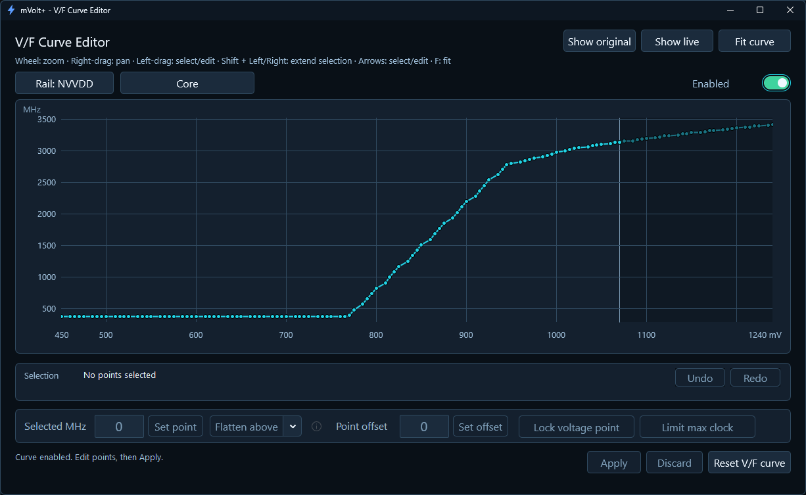
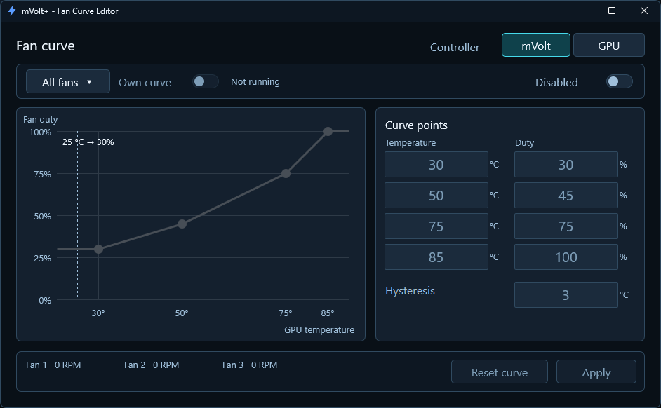
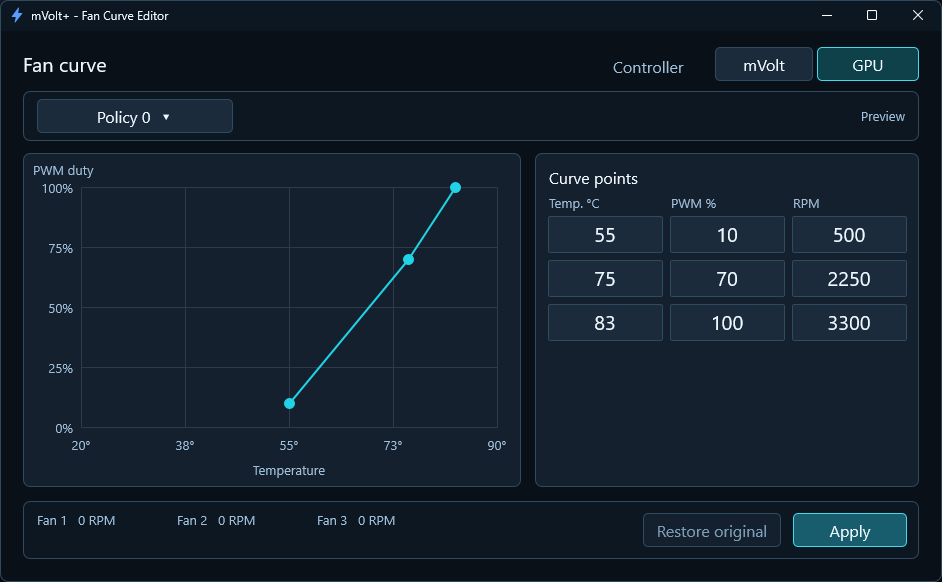
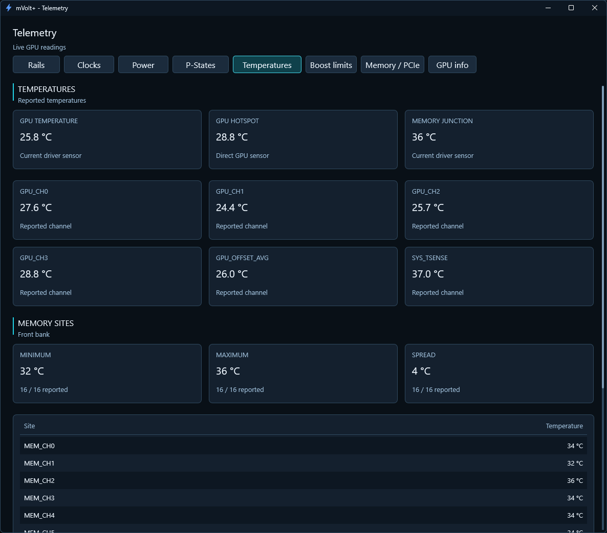
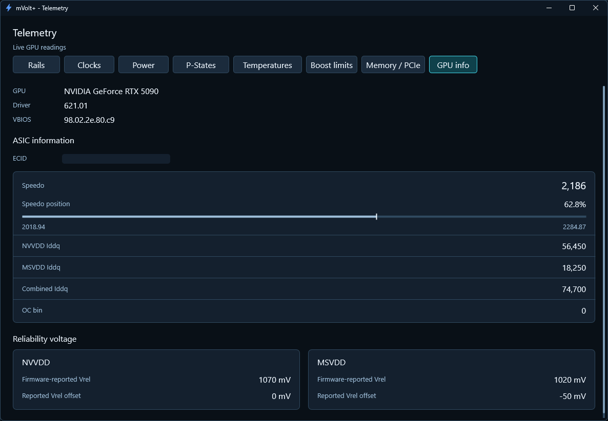
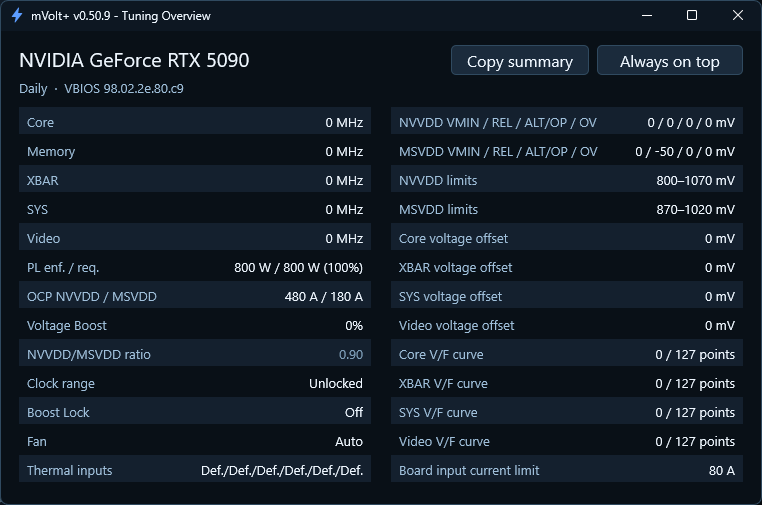
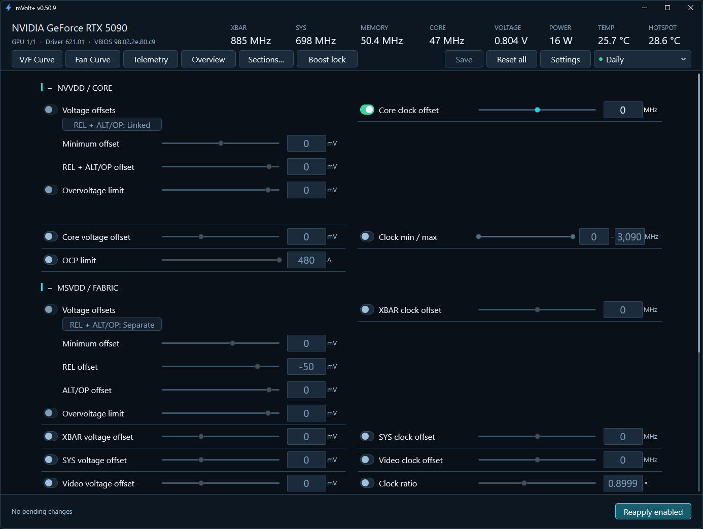
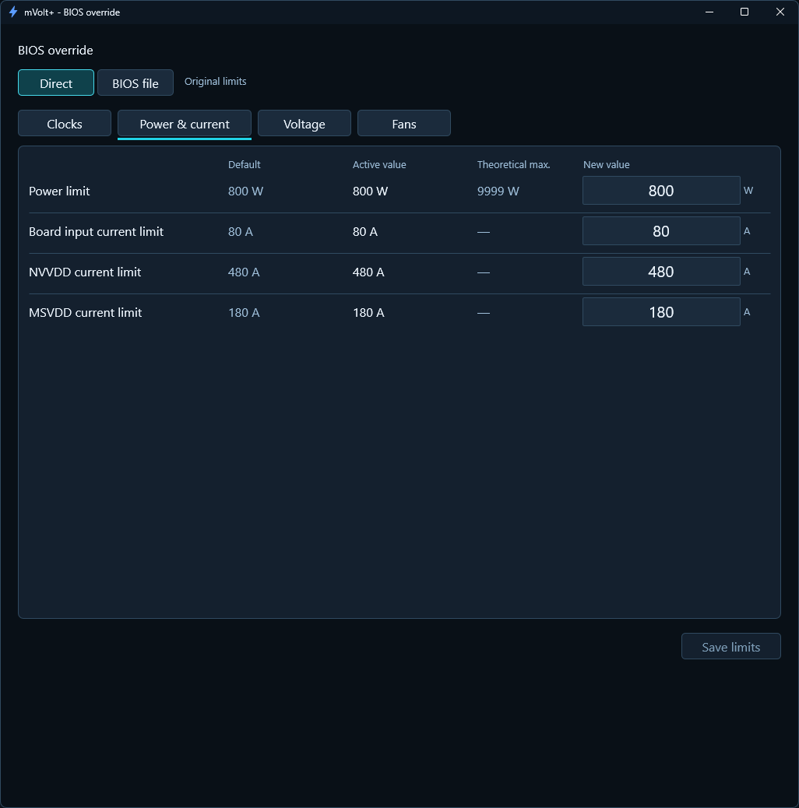
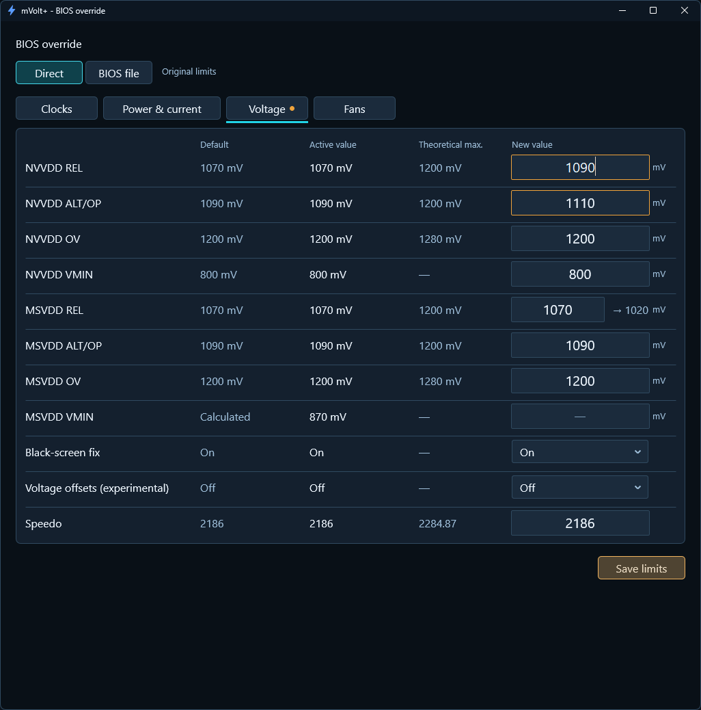

# mVolt+ user guide

**For mVolt+ v0.50.x** · [Back to the project](../README.md) · [Releases](https://github.com/b00nz/mVolt/releases/latest)

This guide covers tuning, profiles, monitoring and startup. Expand a section
for details. Screenshots are from the v0.50.x series.

## Find your way

| Topic | What you will learn |
| --- | --- |
| [How the dashboard works](#how-the-dashboard-works) | Targets, switches, Apply, Reset and Discard |
| [First start and tile presets](#first-start-and-tile-presets) | Three starting layouts and the complete tile table |
| [Dashboard control reference](#dashboard-control-reference) | Every tile, grouped as it appears in the app |
| [Power cap in watts](#power-cap-in-watts) | Watt targets, percentage limits and Reset |
| [BIOS override](#bios-override) | Clock ranges, voltage/current limits, fan settings and recovery |
| [Raising voltage and OCP on 621.01+](#raising-voltage-and-ocp-on-driver-62101-and-later) | Voltage offsets, higher voltage limits and OCP on RTX 50 |
| [BIOS copy](#bios-copy) | Save a copy with GPU-Z or NVFlash |
| [Thermal inputs](#thermal-inputs) | Fixed inputs to VFE, Default, Reset and profiles |
| [Voltage limits and measured voltage](#voltage-limits-and-measured-voltage) | VMIN, REL, ALT/OP, OV, linked editing and MAX |
| [V/F Curve Editor](#vf-curve-editor) | Core and MSVDD curves, point edits, profiles and Core locks |
| [Fan control and persistence](#fan-control-and-persistence) | Fixed duty, firmware auto, curves and hysteresis |
| [Profiles](#profiles) | Saving, applying, full snapshots, details and shortcuts |
| [Startup and tray](#startup-and-tray) | Logon readiness, recovery and closing behavior |
| [Telemetry](#telemetry) | Sensors, graphs, boost reasons, memory timings and PCIe |
| [Overview](#overview) | A compact view of current settings |
| [Settings and layout](#settings-and-layout) | Polling, RTSS, updates, themes, sizing and tile visibility |
| [Advanced tuning](#advanced-tuning) | OCP unlock, XOC and shunt correction |
| [Compatibility and multiple GPUs](#compatibility-and-multiple-gpus) | Selecting hardware and understanding unavailable controls |
| [Command line and automation](#command-line-and-automation) | Read-only commands and immediate tuning requests |
| [Files and logging](#files-and-logging) | Profiles, backups and storage footprint |
| [Troubleshooting](#troubleshooting) | Common questions and useful issue reports |

## How the dashboard works

The header identifies the selected GPU, driver and VBIOS. Its live readings show
supported XBAR and SYS clocks, memory and core clocks, voltage, power, GPU
temperature and supported hotspot temperature.
GDDR6X/GDDR7 memory uses command-clock MHz; hover for the driver-reported frequency.
Below the readings, **Save**, **Reset all** and **Settings** sit beside the
profile selector, which shows the recognized saved profile or **Custom**. Its dot
is green while the applied settings match that profile, amber after you apply
other changes, and grey for **Custom**. **Save** stores the applied settings in
the changed profile; under **Custom** it opens **Save current as…**.

| Label or action | Meaning |
| --- | --- |
| **Enabled** | Allows editing and includes this control when you Apply or restore settings after sleep |
| **Disabled** | Leaves this control out of normal Apply; its existing applied value remains |
| **Target** | The value you are editing; moving a slider updates it immediately |
| **Applied** | The setting currently reported by the driver, separate from measured behavior |
| **Live** | A changing measurement, such as clock, watts or RPM |
| **Allowed** | The editing range available in the current configuration |
| **Review…** | Lists pending changes before you apply them; the latest status appears beside it, and failures show in red |
| **Apply changes** | Applies the values in enabled controls and checks the result |
| **Reapply enabled** | Sends enabled targets again, even with no numeric edits pending |
| **Discard pending** | Discards unapplied edits. Tile and V/F switches stay as they are |
| **Reset** | Immediately restores that card's default; on the watt-cap tile, returns to percentage control |
| **Reset all** (dashboard) | Restores defaults for all supported controls, then disables all tiles and V/F curves after success |

**Disabling a tile leaves it out of Apply and restoration after sleep; it does not reset it.**
Its applied value can still reflect tuning from mVolt+ or another application.
Enable the tile to use its Reset button, or use the dashboard's explicit Reset all.
Minimal uses shared actions and row context menus instead of per-card buttons.

Slider, stepper and text edits are pending until Apply. A card-specific Apply
acts on that card; **Apply fans** acts on the fan tile. Other edits remain pending.
In Standard, each card keeps **Apply** beside **Reset**; Apply stays grey until
that card has a change to apply, including after you return to the applied value.
Pressing **Enter** in a numeric field applies that control. In the V/F and fan
editors, Enter applies the current curve or policy.
**Tab** and **Shift+Tab** move between input fields in reading order and wrap
at the ends; the arrow keys move to the nearest field. The dashboard scrolls the
focused field into view. **Page Up** and **Page Down** step a value like the
card's **+** and **−** buttons. **Esc** closes Settings, About and Review changes.
Reset is immediate and needs no second Apply.
Changing a tile or V/F switch alone does not create a pending tuning change.
Resetting one tile keeps its switches and leaves other unapplied edits alone.
On **Power cap (watts)**, Reset releases the additional cap while keeping the
existing percentage setting; it does not set the percentage to 100%.

**Boost lock**, applying a saved profile and Reset actions are immediate.
Clicking a profile name in the **header menu applies it**; **Details** opens its
saved parameters. Startup application and profile shortcuts also write settings
when configured. Narrowing advanced ranges can write limits;
see [Advanced tuning](#advanced-tuning).

A successful Apply means the driver accepted the settings and mVolt+ checked
the result. Some drivers cannot confirm exact thermal temperatures; these are
labelled **unconfirmed**, although their on/off state is checked.
Success does not guarantee stability under load. Check your own workloads before
making a configuration your automatic startup profile.

## First start and tile presets

On the first interactive start for a new GPU configuration, **Choose your
controls** asks **Which controls would you like to see?** Choose one of three
buttons: **Clock controls**, **Clock + voltage controls**, or **Expert — all
controls**. Each has a short description, and the window explains that you can
change individual tiles anytime in **Sections → Show/Hide tiles**.

The choice changes visibility only; it does not apply settings or turn tuning
controls on. All tiles and V/F curves start disabled, whichever preset you choose.
The dashboard packs the visible tiles together and remembers the
selection. Existing users keep their layout. This chooser does not appear at
logon or for command-line/read-only launches.

| Tile | Clock controls | Clock + voltage controls | Expert |
| --- | :---: | :---: | :---: |
| Core clock offset | ✓ | ✓ | ✓ |
| Memory clock offset | ✓ | ✓ | ✓ |
| XBAR clock offset | ✓ | ✓ | ✓ |
| SYS clock offset | ✓ | ✓ | ✓ |
| Video clock offset | ✓ | ✓ | ✓ |
| GPU clock range | ✓ | ✓ | ✓ |
| Fan control | ✓ | ✓ | ✓ |
| Power limit (%) | ✓ | ✓ | ✓ |
| Power cap (watts) | ✓ | ✓ | ✓ |
| Board input current limit | ✓ | ✓ | ✓ |
| Core voltage limits | — | ✓ | ✓ |
| MSVDD voltage limits | — | ✓ | ✓ |
| Core voltage offset | — | ✓ | ✓ |
| XBAR voltage offset | — | ✓ | ✓ |
| SYS voltage offset | — | ✓ | ✓ |
| Video voltage offset | — | ✓ | ✓ |
| Voltage boost | ✓ | ✓ | ✓ |
| NVVDD OCP limit | — | — | ✓ |
| MSVDD OCP limit | — | — | ✓ |
| NVVDD / MSVDD clock ratio | — | — | ✓ |
| Thermal inputs | — | — | ✓ |
| Thermal limits | — | — | ✓ |
| **Visible tiles** | **11** | **17** | **22** |

Visibility does not guarantee hardware support; an unsupported control remains
unavailable. Hiding a tile does not change its value or whether it is included
in Apply and profiles. Voltage boost, Fan control and both power tiles are
included in every preset, along with Board input current limit.

## Dashboard control reference

Quick tuning contains cards you pin. The remaining sections are ordered
**NVVDD / Core → MSVDD / Fabric → Memory / VRAM → Power / Boost / Cooling**.
Pinned cards move; they are not duplicate controls.

### NVVDD / Core

NVVDD is the core voltage rail. These controls affect core voltage policy,
core clock requests, the clock-range lock and the rail's current limit.

<details>
<summary><strong>Core voltage limits</strong> — VMIN, REL, ALT/OP and supported OV offsets</summary>

Adjusts offsets to the core rail's driver voltage limits. Negative offsets lower
the corresponding limit; positive offsets raise it. The driver baseline can move
with operating conditions, so the resulting limits can change while your offsets
stay fixed.

In Standard, **Applied** shows the current minimum and effective maximum;
**Allowed** shows the rail's current editing ceiling. Details remain in hover
help. These are voltage-policy readings, not measured voltage or pending edits.
Use the range slider and Min/Max fields, or select individual offset controls
in Settings. In the offset view, REL and ALT/OP can be linked or edited separately.

[Read the voltage-limit explanation](#voltage-limits-and-measured-voltage) before
using these controls. Reset restores the rail defaults within the selected
voltage limits; it does not lock the rail to a fixed voltage.

On RTX 50 with driver 621.01 and later, the card shows **Unavailable with this
driver** until BIOS override **Voltage offsets** are on and verified. See
[Driver 621.01 and later](#driver-62101-and-later). To raise core voltage
limits there, use the [BIOS override](#raising-voltage-and-ocp-on-driver-62101-and-later).

</details>

<details>
<summary><strong>Core voltage offset</strong> — the core domain's voltage demand</summary>

Changes the voltage demand for the core clock domain. Positive values ask for
more voltage; negative values ask for less. Another domain sharing the rail or
an active voltage limit may still determine the voltage actually supplied.

This is separate from the **Core voltage limits** card. Reset clears the demand
offset.

</details>

<details>
<summary><strong>Core clock offset</strong> — shift the core frequency request</summary>

Shifts the core frequency requested along the voltage/frequency curve. Positive
values request a higher clock at the same curve voltage; negative values request
a lower clock. Actual speed depends on workload and the GPU's voltage, power,
thermal and clock limits.

The global core offset stacks with regional V/F point offsets. Reset clears
the global offset while preserving the separate regional curve edits. A higher
request can reduce stability without increasing achieved performance.

The allowed global offset follows the driver's current range, including when
saving or applying profiles.

</details>

<details>
<summary><strong>GPU clock range</strong> — request minimum and maximum core clocks</summary>

Requests a minimum and maximum core clock through the driver. A narrower range
constrains clock selection, but other GPU limits can still reduce achieved speed.
It does not set a voltage or guarantee that a requested clock will be held.
Set **Min** to **0** for a maximum-only limit.

Reset releases the clock-range lock. Disabling the tile leaves an already-applied
lock in place. Boost lock can be enabled alongside it; the two controls request
different behaviors and their combined result depends on the GPU and driver.

</details>

<details>
<summary><strong>OCP limit</strong> — NVVDD output-current limit, in amperes</summary>

Sets the output-current limit for the NVVDD core rail. Lower values can make
current limiting reduce core boost sooner; higher values permit more current
within the other active limits. This is a driver policy setting, not measured
current or the board's power budget.

The ordinary range is capped at the firmware default where available. **Unlock
OCP limits** in Settings exposes the extended supported range; it is unavailable on
RTX 50 with driver 621.01 and later. Reset returns this channel to its firmware default.
To raise that default, use the BIOS override
[NVVDD current limit](#current-limits).

The driver must report a consistent minimum, default and maximum for this
channel. A fixed range is valid, but missing or contradictory bounds leave
adjustment unavailable; mVolt+ does not invent a wider range.

</details>

### MSVDD / Fabric

MSVDD supplies the GPU fabric. Its voltage and current controls are separate
from VRAM tuning in the Memory section.

On supported hardware, the [V/F editor](#vf-curve-editor) also offers separate
XBAR, SYS and Video curves. Their regional adjustments work alongside the
global clock offsets below.

<details>
<summary><strong>MSVDD voltage limits</strong> — fabric-rail voltage-policy offsets</summary>

Adjusts VMIN, REL, ALT/OP and supported OV offsets for the MSVDD fabric rail,
using its own reported limits. Linked editing works as on the core rail card.

Changing fabric voltage limits can constrain fabric clocks; core/fabric clock
propagation and other limits can influence the result. This card does not directly
set VRAM voltage. See [Voltage limits and measured voltage](#voltage-limits-and-measured-voltage),
including the different MSVDD Reset default.

On RTX 50 with driver 621.01 and later, the card shows **Unavailable with this
driver** until BIOS override **Voltage offsets** are on and verified. See
[Driver 621.01 and later](#driver-62101-and-later). To raise MSVDD voltage
limits there, use the [BIOS override](#raising-voltage-and-ocp-on-driver-62101-and-later).

</details>

<details>
<summary><strong>XBAR voltage offset</strong> — crossbar voltage demand</summary>

Changes the voltage demand for the crossbar fabric domain. Positive values ask
for more voltage; negative values ask for less. Shared rail demands and active
voltage limits can keep actual voltage from following the request directly.

It is independent of the XBAR clock offset, regional curve adjustments and
MSVDD rail-limit offsets.
Reset clears this domain's voltage-demand offset.

</details>

<details>
<summary><strong>XBAR clock offset</strong> — crossbar fabric frequency</summary>

Shifts the crossbar fabric clock request. A higher offset requests a faster
fabric clock; a lower offset reduces the request. Core/fabric propagation, the
fabric V/F relationship and other GPU limits can prevent the requested change
from appearing in the measured clock.

Use the XBAR **Live** reading or Telemetry's measured clocks to inspect the result.
Reset clears this global clock offset while preserving regional curve edits.

</details>

<details>
<summary><strong>SYS voltage offset</strong> — system-domain voltage demand</summary>

Changes the voltage demand for the GPU system domain. Positive values ask for
more voltage; negative values ask for less. Another domain sharing its rail,
or a voltage-policy limit, can determine the voltage actually supplied.

This is separate from SYS frequency and either rail's REL and ALT/OP limits.
Reset clears the demand offset.

</details>

<details>
<summary><strong>SYS clock offset</strong> — system-domain frequency</summary>

Shifts the GPU system clock request. Positive values request a higher frequency;
negative values request a lower one. The driver may round the offset to a
supported clock step, while workload and voltage/power limits affect measured
speed. Compare **Applied** with **Live**; Reset clears the global offset while
preserving regional curve edits.

</details>

<details>
<summary><strong>Video voltage offset</strong> — video-domain voltage demand</summary>

Changes the voltage demand for the GPU video domain. Positive values ask for
more voltage; negative values ask for less. Shared rail demands and active
voltage limits can restrict the resulting voltage.

Reset clears this domain's voltage-demand offset.

</details>

<details>
<summary><strong>Video clock offset</strong> — video-domain frequency</summary>

Shifts the clock request for the GPU video domain. Positive values request a
higher frequency and negative values a lower one. Whether this changes measured
speed or workload performance depends on the active task and other GPU limits.

Reset clears the global offset while preserving regional curve edits.

</details>

<details>
<summary><strong>OCP limit</strong> — MSVDD output-current limit, in amperes</summary>

Sets the output-current limit for the MSVDD fabric rail. Lower values can
constrain fabric boost sooner; higher values permit more current within other
active limits. It is a driver policy setting, not measured current or proof of
the regulator's physical protection threshold.

**Unlock OCP limits** expands the editable range beyond the firmware default
where supported; it is unavailable on RTX 50 with driver 621.01 and later. Reset restores
this rail's firmware current limit. To raise that limit, use the BIOS override
[MSVDD current limit](#current-limits).

</details>

<details>
<summary><strong>NVVDD / MSVDD clock ratio</strong> — fabric clock demand relative to core</summary>

Adjusts the fabric clock request relative to the GPU core. A lower value requests
less fabric frequency; a higher value requests more. Actual clocks depend on
their V/F curves, workload and GPU limits. This does not set either rail's voltage.

**Applied** shows the current setting. **Measured XBAR/GPC** compares the current
XBAR and core clocks; it can differ from the configured ratio, especially at idle.
Increasing the target does not guarantee higher measured clocks.

Reset restores the driver-reported default when available.

</details>

### Memory / VRAM

<details>
<summary><strong>Memory clock offset</strong> — shift the VRAM clock request</summary>

Shifts the memory clock request above or below its default. A higher offset can
increase available bandwidth, but excessive offsets can reduce stability or
performance. A successful Apply does not establish error-free operation.

Live memory clocks depend on the performance state. Clock frequency and effective
memory transfer rate can use different conventions, so numbers from different
tools are not always directly comparable. Reset clears the memory offset.

Targets are checked against the driver's current offset range. Profiles and
the CLI use the same range checks as dashboard Apply.
To change the available ceiling where supported, use
[BIOS override](#bios-override).

</details>

### Power / Boost / Cooling

<details>
<summary><strong>Power limit</strong> — board-power budget, as a percentage</summary>

Sets the board-power budget as a percentage of the driver default. Lowering it
can reduce power consumption and boost clocks under load; raising it permits
more power within the supported range. The GPU only draws what its workload
and active limits allow.

The range comes from the selected GPU. In Telemetry, compare **Requested limit**,
**Enforced limit** and measured board power: they are different readings, and
enforcement can lag a request. Reset restores the board's default limit.

Percentage editing is disabled while a watt cap is selected or active.
Use **Reset** on the watt-cap tile to
return to percentage editing; see [Power cap in watts](#power-cap-in-watts).

</details>

<details>
<summary><strong>Power cap (watts)</strong> — a board-power budget in watts</summary>

Sets a watt cap and, on supported GPUs, aligns the board-power request with it.
Standard shows Target, Applied, Live and Allowed; Minimal uses a compact row.
Reset returns to percentage control without resetting it to 100%.

See [Power cap in watts](#power-cap-in-watts) for examples, limits and persistence.

</details>

<details>
<summary><strong>Board input current limit</strong> — board-current limit, in amperes</summary>

Sets the board's input-current request independently of its power budget and
the NVVDD/MSVDD output OCP limits. Enable the tile, enter amps, then Apply.
Values support up to three decimal places within the current driver range.

Applied is the requested limit, not measured current. Reset restores the
driver-reported default. Profiles and Overview include this setting; disabling
the tile or closing mVolt+ does not undo it.

On RTX 50 with driver 621.01 and later, only the main limit is used; the
auxiliary limit is unavailable. See [Driver 621.01 and later](#driver-62101-and-later).

</details>

<details>
<summary><strong>Voltage boost</strong> — additional voltage headroom for GPU Boost</summary>

Adjusts how much additional voltage headroom GPU Boost may use. A higher value
allows more of the available boost-voltage range; it does not force a particular
voltage or increase physical voltage by that percentage.

Workload, reliability, power and thermal limits still apply. Voltage Boost can
change the baseline used to evaluate rail limits, even when the rail offsets
themselves have not changed. Reset returns this control to its default.

On desktop RTX 50 cards, 0 % keeps each rail at its REL limit and 100 % adds
the REL to ALT/OP gap to every rail, usually 20 mV. If the rails' gaps differ,
the smallest one counts. A REL raised in the
BIOS override gets the same headroom on top; see
[Raising voltage and OCP on driver 621.01 and later](#raising-voltage-and-ocp-on-driver-62101-and-later).

With BIOS override **Voltage offsets** turned on (RTX 50, driver 621.01 and
later), Voltage boost is held at 0 % until mVolt+ verifies them. After that,
mVolt+ applies Voltage boost itself: it raises REL by its share of the smallest
ALT/OP − REL gap.

Voltage boost is checked separately from voltage-limit editing and may also
be available on older GeForce cards. Availability depends on the GPU and driver.

</details>

<details>
<summary><strong>Thermal inputs</strong> — fixed temperatures for VFE calculations</summary>

Sets independent fixed inputs for **GPU temp**, **Hotspot**, **Memory** and
**Internal 3–5**. **Default** leaves the input to the GPU; **Reset** restores it
immediately. GPU temp replaces reported GPU temperature, affecting mVolt+ and
other tools that use this sensor. Memory replaces reported memory temperature.
Hotspot sets the temperature the hotspot limit sees.

See [Thermal inputs](#thermal-inputs) for entering temperatures, selecting channels
and saving profiles.

</details>

<details>
<summary><strong>Thermal limits</strong> — GPU, hotspot and memory temperature limits</summary>

Sets the temperatures where thermal slowdown begins, in °C. Each limit has its
own **Include** and **Reset**:

| Limit | Range |
| --- | --- |
| GPU | −40 to 105 °C |
| Hotspot | −40 to 110 °C |
| Memory | −40 to 105 °C |

Lower values can make thermal limiting reduce clocks sooner. Values outside the
range are rejected when the field loses focus and by **Apply changes**. Row
Reset restores that limit's original thresholds; the tile's **Reset all**
restores all three. Limits stay after mVolt+ closes.

A fixed GPU temp [thermal input](#thermal-inputs), including the LN2 preset,
changes what the GPU limit sees. Higher entries do not guarantee a higher
effective limit; behavior above the original limits is unverified.

</details>

<details>
<summary><strong>Fan control</strong> — fixed duty for all fans or individual channels</summary>

Sets a fixed fan duty, in percent. Each slider follows a driver-reported fan
channel and its own duty limits. A channel may drive more than one physical fan;
the displayed channel count does not necessarily match the number of fans.

**All fans** sets a shared pending target within the range supported by every
channel. Individual sliders change only their own channel. Different targets
make the shared control show **Mixed**. Moving All fans again replaces those
targets. Zero duty is available only where the driver allows it.

**Apply fans** applies the fan tile's settings; the dashboard's Apply button can
apply them too.
Applying fixed duty replaces an active software fan curve. RPM depends on fan
hardware and operating limits, so duty percent is not an RPM percentage.

**Reset to auto** immediately returns all channels to firmware control. Fixed
duty remains after exit. [Compare the fan modes](#fan-control-and-persistence).

</details>

### Header action: Boost lock

**Boost lock** immediately requests the GPU's boost performance mode instead of
normal idle downclocking. It can raise idle power consumption. It does not remove
voltage, power or thermal limits, nor guarantee a particular frequency.
Click it again to release the request. Boost lock acts immediately; profiles
saved while it is on restore it.

Set a global **Toggle Boost Lock** shortcut in [Settings → Hotkeys](#hotkeys).
It works while mVolt+ is running, including in the tray.

It is separate from **Voltage boost** and **GPU clock range**. mVolt+ allows a
clock range and Boost lock together; evaluate their combined behavior on your
hardware. Disabling the clock-range tile does not release an applied lock.

## Thermal inputs

**GPU temp** (channel 1) and **Internal 3–5** (channels 3–5) provide fixed
temperatures for the GPU's **voltage/frequency calculations (VFE)**. **Memory**
(channel 2) replaces memory temperature. **Hotspot** (channel 0) sets the
temperature the hotspot limit sees; the hotspot reading still shows the real
sensor. Values are temperatures in °C, not offsets. Their effect depends on the
GPU's firmware.

| Control | What it does |
| --- | --- |
| Temperature field | Enter a fixed temperature, then press Apply to use it |
| Default | Lets the GPU supply that channel's input; it does not mean 0 °C |
| Include | Selects the channel for Apply and normal profiles |
| Tile Enabled/Disabled switch | Includes or excludes the channels together; turning it off does not undo an applied input |
| Apply | Applies changes for included channels; highlighted when changes are waiting |
| Reset all | Replaces Apply when there are no included changes to apply. Immediately restores every available thermal channel to Default. Include switches stay unchanged |
| Row Reset | Immediately restores Default for that channel without changing the other rows or their switches |

This tile's **Reset all** affects thermal inputs only. The dashboard's **Reset
all** restores defaults across all supported controls.

Clicking a **Default** field clears the placeholder. Leave it empty and it returns
to Default when focus moves away; type **0** to request an actual fixed **0 °C**.
Reset followed by an unchanged Apply keeps Default. No verified input range is
reported, so the tile does not invent slider endpoints.

GPU temp replaces the reported GPU temperature. This affects mVolt+, its
software fan curve and other tools that use the same temperature sensor.

**LN2 boost preset** fills GPU temp = +5 °C, Internal 3 = 0 °C, Internal 4 = −20 °C
and Internal 5 = Default. It leaves Memory and Hotspot unchanged. Press **Apply** to send
these values. The preset and Reset actions are greyed out with the tile.

Some drivers cannot confirm the requested temperature. These values are marked
**unconfirmed** and cannot be saved in profiles. Reset can still confirm that
the override is off.

Both profile modes save applied channel settings, including Default, and leave
out pending edits. Normal profiles apply only channels included in the profile;
full snapshots also restore saved channels whose Include switch was off.
Profiles without thermal inputs leave them alone. Closing mVolt+ does not undo
an applied fixed input.

## Power cap in watts

**Power cap (watts)** sets a board-power budget. It can cap power below the
percentage slider's minimum and uses the currently available maximum, including
verified [BIOS overrides](#bios-override).

Enable the tile, enter a watt target, then choose **Apply changes**. New targets
start at **1 W**, accept up to three decimal places, and must fit the current
reported maximum.

| Tile line | What it means |
| --- | --- |
| **Target** | The watt value being edited; without a cap it starts at the power limit in force on supported GPUs |
| **Applied** | The cap read back from the driver, or **No cap** when no request exists |
| **Live** | Measured board power, using the same reading as the percentage tile |
| **Allowed** | 1 W through the driver's current maximum |
| **Pending** | An edit waiting for Apply; it is not yet the applied cap |

### Percentage and watt limits together

Use percentage or watts to choose the power budget. On supported GPUs, applying
a watt target also updates the board-power request, so an older percentage
setting does not keep that request lower. Below the ordinary minimum, the watt
cap still provides the lower ceiling.

Some GPUs support only an additional cap. On those systems, the existing
percentage request remains separate and the lower request can limit power.
Check **Requested limit** and **Enforced limit** in Telemetry → Power.

On laptops whose BIOS allows more power than the driver enforces, the cap also
raises the laptop's own power request and its CPU+GPU budget by the same amount.
Reset returns both. Desktop cards are unaffected.

A cap is a ceiling, not a target for consumption. An idle GPU or a light workload
can draw much less than the applied value.

### Reset and closing

**Reset** immediately raises the watt cap to the driver's current maximum so
the percentage limit can take over. It keeps your percentage setting and leaves
other pending edits alone. Applied may still show a watt value because the cap
has been raised, not deleted. Other board-power requests left below your
percentage setting are raised to it, so no stale cap remains.
In Minimal, right-click the power-cap row and choose **Reset power cap**.

Disabling or hiding the tile, resetting app preferences, or closing mVolt+ does
not remove an applied cap. A cap from another application can also disable
percentage editing; choosing Reset explicitly replaces that cap too.

If an interrupted operation leaves recovery pending, use Reset to return to
percentage control. Further cap changes remain blocked until recovery succeeds.
Keep the recovery data if Reset fails; deleting it does not restore the GPU.

On a laptop, choose Reset before going back to an older mVolt+ version.

See [Power controls in profiles](#power-controls-in-profiles) for saved settings
and switching between percentage and watt-cap profiles.

## Voltage limits and measured voltage

**Both rail-limit cards adjust offsets to the driver's voltage limits. The
resulting limits can change with operating conditions, even when your offsets
stay unchanged.**

### Range slider and offset views

New configurations start with **Range slider**. Choose **Settings → Appearance →
Voltage controls** to switch between the range slider and individual offset
controls. Existing saved view preferences are preserved.

The range slider's lower handle and **Min** field adjust VMIN. Its upper handle
and **Max** field calculate REL and ALT/OP offsets separately from their current
baselines. These fields show estimated voltages in mV. **OV can still restrict the
effective maximum.** Its independent switch includes or excludes OV from Apply;
turning it off does not clear an already-applied offset.

In the offset view, fields show signed mV offsets directly. REL and ALT/OP can be
linked or edited separately. Both views edit the same pending settings;
changing views alone does not apply or reset them.

The range view estimates the result from current baselines. It does not hold an
absolute voltage when the driver later changes those baselines. Standard's
**Applied** line shows the readback minimum and effective maximum; **Allowed**
shows the validated ceiling for that rail and mode. Details are in hover help.

| Control or reading | What it means | Effect of changing it |
| --- | --- | --- |
| **Minimum offset (VMIN)** | Offset to the minimum-voltage policy | Lowering reduces the minimum request; raising can hold the rail at a higher requested minimum. Other policy and operating constraints still apply. |
| **Reliability offset (REL)** | Offset to the reliability voltage limit | Raising permits a higher REL limit; lowering makes it more restrictive. It does not force the rail to use that voltage. |
| **Operating limit offset (ALT/OP)** | Offset to the maximum operating-voltage limit, also called Vop | Raising permits a higher operating limit; lowering makes it more restrictive. REL, OV and other active limits can still constrain the result. |
| **Overvoltage offset (OV)** | Offset to the overvoltage policy ceiling | A sufficiently lower OV can constrain the effective maximum. Raising it may have no effect while another limit remains tighter. |
| **Applied maximum / MAX** | The driver's evaluated upper limit now | Read-only. Reports the current policy result, not pending edits or measured rail voltage. |

The numerical range a control accepts is not a recommended operating range.
The voltage device's reported range is separate from the policy-offset ranges.
[How XOC affects the ceiling](#advanced-tuning).

<details>
<summary><strong>Why changing REL alone may do nothing</strong></summary>

Another applicable limit can still constrain the maximum. If REL rises while
ALT/OP or OV remains more restrictive, MAX may stay unchanged. Even when MAX rises,
the workload may not request more voltage or another power/clock limit may intervene.

Watch the evaluated limits, then compare physical sensor readings under comparable
conditions. Do not assume every GPU or operating state requires both REL and ALT/OP
to change.

</details>

<details>
<summary><strong>Linked versus separate REL and ALT/OP editing</strong></summary>

**Linked** presents one REL + ALT/OP offset control. A deliberate edit sets the
same offset in both pending fields. **Separate** exposes each offset on its own.
Profiles with unequal values retain them and open in separate mode.

Changing the editing mode alone does not apply or overwrite existing values.
If you link unequal targets, **Mixed** remains until you deliberately enter a
shared offset. Linking matches offsets, not absolute voltages: the driver
baselines can differ and move independently.

</details>

<details>
<summary><strong>What the header voltage measures</strong></summary>

The header averages valid current core/NVVDD ADC samples. It excludes the
SYS/MSVDD sensor. This is an average across available sensors in a snapshot,
not a time average.

Telemetry exposes individual ADC readings and separate rail policy readings.
Another tool may show a different sensor, sampling instant or averaging method.
Compare the sensor meaning as well as its label; MAX and voltage limits are not
physical voltage measurements.

</details>

<details>
<summary><strong>What Reset does on the rail cards</strong></summary>

NVVDD Reset clears VMIN, REL and ALT/OP offsets. MSVDD Reset clears VMIN and ALT/OP
and restores mVolt+'s established **−50 mV REL** default. Supported OV offsets
are cleared. If the default REL would exceed the current mode/device ceiling,
the reset request is limited to that ceiling.

These defaults do not produce the same absolute voltage across workloads or GPUs.
A saved **0 mV** offset means no offset. It does not ask mVolt+ to run Reset later.

</details>

### Driver 621.01 and later

On RTX 50 cards, driver 621.01 and later no longer apply NVVDD/MSVDD
voltage-limit offsets, a raised OCP maximum or the board-current auxiliary
limit. The driver accepts these writes and reports success, but the GPU keeps
its previous limits; the limits appear to be enforced below the driver. On
RTX 50 with these drivers, mVolt+ disables:

- **Core voltage limits** and **MSVDD voltage limits**, including OV. Both cards
  show **Unavailable with this driver**.
- **XOC voltage range** and **Unlock OCP limits** in Settings.
- The auxiliary limit in **Board input current limit**; the main limit still
  works up to the stock limit. Raise that with the
  [BIOS override](#raising-voltage-and-ocp-on-driver-62101-and-later).

Everything else is unaffected. RTX 20, 30 and 40 cards keep these controls on
621.01 and later. On RTX 50, driver 617.42, the latest before the 621 branch,
and all earlier drivers support every control; mVolt+ enables them
automatically there. Profiles with voltage limits still apply on 621.01 and
later; the voltage limits are skipped and a note is shown. A BIOS override
saved on an older driver stays active, and **Remove BIOS override** is always
available.

To use the voltage-limit cards again, turn on **Voltage offsets (experimental)**
in the BIOS override. Once mVolt+ verifies them, both cards, **XOC voltage
range**, profiles and the CLI rail options work as on older drivers. To raise
voltage limits or OCP on these drivers, use the BIOS override; see
[Raising voltage and OCP on driver 621.01 and later](#raising-voltage-and-ocp-on-driver-62101-and-later).

## V/F Curve Editor

The editor changes the frequency requested at individual voltage points.
Choose **Core**, **XBAR**, **SYS** or **Video** above the graph. The rail selector
groups the curves by their reported rail; available curves depend on your GPU
and driver.

The horizontal axis is voltage in **mV**; the vertical axis is frequency in
**MHz**. Each curve keeps its pending edits, selection, view and Undo/Redo history
when you switch domains. Opening or switching a curve does not apply anything.
Hover the instruction line for help; the graph stays clear of instruction tooltips.

Each curve has its own **Enabled** switch. Enable it before editing. Disabled
curves are greyed out and cannot be edited, applied or reset; disabling a curve
does not change the GPU. Opening or switching curves never enables them.



| Action | Result |
| --- | --- |
| Click a point | Selects the point |
| Mouse wheel over the graph | Zooms around the pointer; voltage and frequency axes update together |
| Fit curve / F | Restores the full view without changing points or locks |
| Left / Right with graph focus | Selects the adjacent point and brings it into view when zoomed |
| Shift + Left / Right with graph focus | Extends or shrinks a contiguous selection from the original point; reversing direction shrinks it |
| Up / Down with graph focus | Moves every selected point by 15 MHz, preserving the selection and curve shape |
| Drag a point vertically | Changes its pending frequency; press Apply to use it |
| Right-drag the graph while zoomed | Pans the view in both directions without changing curve points |
| Left-drag empty graph space at any zoom, or Shift+left-drag from a point | Selects a region; dragging a selected point moves the selection |
| Selected MHz → Set point | Sets the selected point's pending frequency |
| Point offset → Set offset | Sets the selected points' pending frequency offsets |
| Enter in a frequency or offset field | Applies the selected curve with the entered value |
| Flatten above | Sets the selected point to **Selected MHz** and flattens the points after it, keeping the current graph scale |
| Flatten above chevron | Chooses **Drop tail** (default) or **Match tail**; the choice is remembered |
| Info button beside the chevron | Previews both modes on this curve |
| Lock voltage point (Core only) | Immediately requests the selected point's voltage bin; click Release voltage point to release it |
| Limit max clock (Core only) | Immediately caps core frequency at the selected point's displayed frequency, including pending edits; click Release clock limit to release it |
| Undo / Redo | Restores pending edits; a drag is one history step |
| Apply | Writes and verifies the selected curve; other curves' pending edits stay pending |
| Discard | Returns the selected curve to its applied state without resetting it |
| Reset V/F curve | Immediately clears the selected curve's regional adjustments, preserving its global clock and voltage-demand offsets |
| Show live / Hide live (Core only) | Shows or hides the live operating-point marker and its readout for this app session |
| Show original / Hide original | Shows or hides a thin reference curve without applying changes |

The editor's **Apply** is available when the enabled curve has pending point
changes. Switching it on alone does not activate Apply. Dashboard **Apply changes**
can apply enabled curves and tiles together. Apply changes before saving them
in a profile.

The thin reference line follows the appearance theme. For MSVDD curves it is
an estimate without the point adjustments; hover **Show original** for details.

Ctrl+Z and Ctrl+Y work when the graph has focus. Applying, discarding or refreshing
the curve starts a new edit history. Click the graph before using its arrow keys.
While a numeric field has focus, Left/Right move its text caret instead of
selecting another curve point.

### Global offsets and curve adjustments

The Core, XBAR, SYS and Video clock-offset tiles change their domain's global
frequency offset. Curve edits adjust individual points or regions alongside
that global setting. **Set offset** replaces the selected points' offsets.
Applying the same value again does not add it twice.

Resetting a curve preserves its global clock offset and voltage demand. Resetting
one curve does not reset the others. Applied curve edits remain after mVolt+
exits until changed or cleared by the driver.

Voltage demand is separate from frequency adjustment. Core voltage demand can
shift the displayed Core voltage axis. MSVDD curves use reference voltage points,
so changing XBAR/SYS/Video voltage demand does not move their horizontal axis or
rewrite their point offsets. Shared rail demands and other GPU limits determine
the voltage and clocks actually reached; use Telemetry to inspect those readings.

**Flatten above does not lock voltage.** It shapes frequency at higher-voltage
points; the GPU still selects an operating point under its active limits.

| Mode | What it does |
| --- | --- |
| **Drop tail** (default) | Sets the later points to a combined −1000 MHz offset, or lower where needed, so they stay flat. This is the generally recommended way to undervolt. |
| **Match tail** | Gives each later point its own offset: exact now, but warming can lift some above the selected point. |

The preview's warming slider illustrates how heat from real workloads could shift
each tail. Hollow dots mark lowered points that the driver lifts to the plateau. Voltages past the
rail's current voltage limit are shaded and their points dimmed; hovering such a
point shows the limit.

### Core live readings and locks

The live marker uses the core ADC voltage average, matching the dashboard header,
and the current driver-reported core clock. It shows measured operation rather
than selecting an exact curve point. It does not follow pending curve edits.
Missing or stale readings hide the marker; readings outside the zoomed view are
not pinned to the graph edge. Zooming and panning update both axes without
changing settings.

The editor opens without automatically selecting the first point. Core live readings
start hidden; **Show live** enables them and keeps that choice for this app
session. **Fit curve** restores the full view after flattening or navigating.

Select one point to use either lock button. Locks can be set while curve edits
are pending; locking does not apply or discard those edits. A voltage lock follows
the applied curve until you apply its frequency changes. The editor shows an active voltage lock as a vertical line, or an
active clock ceiling as a horizontal line, based on the GPU's current setting.

These two actions replace each other and the header's Boost lock. **Limit max
clock** is unavailable while a GPU clock-range lock is active; release that range
first. A voltage-point lock can coexist with the GPU clock range. Other GPU
limits still apply, so a lock does not guarantee the measured clock or voltage.

The lock buttons act immediately. Profiles saved while a lock is held restore it.
Locks remain applied after exit until released or cleared by the driver.
**Reset all** releases them; **Reset V/F curve** only resets curve offsets.

## Fan control and persistence

Choose a mode based on who should adjust fan duty as temperature changes.

| Mode | Who changes duty? | In the tray | After fully exiting |
| --- | --- | --- | --- |
| **Firmware automatic** | GPU firmware | Firmware continues | Firmware continues |
| **Fixed duty**, from the fan tile | Your applied percent target | Duty remains fixed | Last duty remains fixed |
| **mVolt+ fan curve** | mVolt+, using GPU temperature | Curve tracks temperature | Tracking stops; last duty remains fixed |
| **GPU fan policies** (experimental) | GPU firmware | No software curve is required | mVolt+ does not reset the edited policy |

**The mVolt software curve is not uploaded to firmware.** Saving its points in a
profile does not make firmware execute them. Use **Close window to tray** to
hide the window while mVolt+ continues controlling the fans.

The editor's **mVolt / GPU** selector chooses the controller to edit. Switching
views keeps pending edits and does not apply anything. In **mVolt** mode, drag
the graph or enter each point's **Temperature** and **Duty** directly.

With more than one fan channel, the **All fans** menu picks the curve to edit:
**All fans** edits the shared curve, and **Fan 1**, **Fan 2** and so on select
one fan. For one fan, turn on **Own curve** to give it its own curve, starting
from the shared points; turning it off removes that curve. Fans without their
own curve follow the shared one, and other curves are drawn faintly behind the
edited one. The **Enabled** switch and fall hysteresis stay shared. With own
curves applied, the fan tile reads **Per-fan curves**.



In **GPU** mode, choose a policy and edit **Temperature**, **PWM duty** and **RPM**
for each of its three points. Temperatures must increase from point to point;
PWM and RPM targets must stay level or increase. **Apply**, or Enter in a field,
activates the policy and stops the mVolt software curve.
**Restore original** restores the saved pre-edit policy, which is kept between
launches and is not necessarily the card's factory setting.



GPU policies can be saved in profiles and used with **Apply startup profile,
then exit**. Saving captures the applied temperatures, PWM and RPM targets.
Older temperature-only profiles keep the current speed targets when applied.

GPU mode is experimental. Policy numbers are not physical fan labels, and
firmware response and reset/reboot persistence depend on the hardware.

<details>
<summary><strong>Build and apply a fan curve</strong></summary>

1. Open **Fan Curve**, choose **mVolt** and set the curve to **Enabled**.
2. Drag points or enter their temperature and duty. Double-click to add a point;
   right-click a point to remove it.
3. Choose the fall hysteresis.
4. Click **Apply**. Pending edits do not replace the running curve before Apply.

Without own curves, the software curve drives all reported channels together
within their shared supported duty range; with own curves, each channel uses its
own range. A 0% point returns the fans to automatic control where
the GPU cannot stop them.
To return to firmware control, set the curve to **Disabled** and press **Apply**,
or use the dashboard's immediate **Reset to auto**. The fan-curve switch starts
or stops automatic fan control when you press Apply, even if no curve points
changed.

**Reset curve** restores and immediately applies the default points of the shown
curve, and with **All fans** also the default hysteresis, while keeping the
curve's **Enabled** switch as it is. It differs from Reset to auto.

</details>

<details>
<summary><strong>Why fall hysteresis defaults to 3 °C</strong></summary>

Fall hysteresis holds the higher fan duty until temperature has fallen enough.
This reduces repeated speed changes near a boundary. A larger value holds higher
duty longer; a smaller value lets the curve reduce duty sooner. Rising temperature
can still increase duty immediately.

The default is **3 °C**, and you can adjust it.

</details>

Pausing monitoring or hiding the dashboard does not stop an active curve's
required temperature checks. If a temperature read fails, the controller holds
the last duty until valid readings return. A driver reset can change fan state;
the Applied reading shows the current setting.

## Profiles

Profiles save applied settings and enabled/disabled switches. Applying a profile
restores its saved switches. Each GPU and BIOS has its own profiles.

### Normal profiles and full snapshots

| Saved control | Normal profile | Full snapshot |
| --- | --- | --- |
| Saved and enabled | Applies its saved value, including zero/default values | Applies its saved value |
| Saved and disabled | Leaves the current GPU setting unchanged | Restores its saved value |
| Missing or unavailable when saved | Leaves the current GPU setting unchanged | Leaves the current GPU setting unchanged |

Leave the save form's **Full snapshot** checkbox unchecked for a normal profile,
or check it to include disabled settings. It starts unchecked; a successful
new-profile save remembers your choice for this GPU. Overwriting an existing
profile keeps its saved mode. Normal previews show only the settings the
profile will apply.

**Saving or overwriting a profile saves applied settings in both modes.**
Unapplied slider values, fan-mode changes, thermal inputs and V/F curve edits
stay in the editor.

For an enabled control that has already been applied, saving keeps its applied
value, not its pending edit. For example, with **+250 MHz** memory applied and
**+500 MHz** pending, both modes save **+250 MHz**.

Controls enabled only for an unapplied edit are not saved as enabled. Switching
a control off also keeps it disabled in the profile. An applied zero or default
value can still be an enabled setting; zero does not mean excluded.
Full snapshots restore saved values even for controls disabled in the profile.
Existing profiles retain their saved values and switches until overwritten.

When switching normal profiles, untouched settings remain applied. If profile A
(or any other software) applies a V/F curve and fan settings, then profile B
changes only power, that curve and those fan settings stay active. A full snapshot
instead restores all its saved settings, so it can replace tuning from
another profile or application.

Both modes save held clock locks: Boost lock or the V/F editor's voltage point,
plus a maximum-clock limit. A normal profile without a lock leaves the current
lock alone; a full snapshot restores its saved lock state. A profile cannot
combine a locked **GPU clock range** with a maximum-clock limit. **Reset all**
releases the locks.

A snapshot can restore the default power limit even if the tile was disabled
when saved, as long as that was the value reported by the GPU. Disabling a tile
does not reset its value.

### Curves in profiles

Core, XBAR, SYS and Video curves are saved separately. Both modes save applied
curve values, leaving out pending changes. Saved curves apply the same way from
the app, a shortcut, at Windows startup or through the CLI.

Each curve has an independent **Enabled** switch, separate from its global
clock-offset tile. Normal profiles save enabled curves that have already been
applied. Turning a curve off leaves it out of a normal save. Opening it or
leaving an edit pending does not include it.
A previously applied curve can be saved again without changing its points.
Full snapshots save supported curves even when disabled and restore every
saved curve.

Normal profiles can be saved even when excluded curves cannot be read.
Included curves and full snapshots still need current GPU readings.

A profile without a particular curve leaves it unchanged. For example, an older
profile with no XBAR curve leaves the current XBAR curve in place. A curve
disabled in the profile also stays unchanged in normal mode.

To save a reset curve in a full snapshot, select that curve, use **Reset V/F curve**,
then save or overwrite the snapshot. Reset each curve you want to clear.
Merely opening a curve or disabling a control does not reset it.

Profiles containing MSVDD curves need a version that supports them. Keep a backup
before returning to an older release. A saved curve that no longer matches the
selected GPU's curve is refused rather than applied to different points.

### Power controls in profiles

Normal profiles save the applied watt cap, leaving out pending edits. Applying
one sets the cap only when it is enabled in the profile. Otherwise, the existing
cap stays unchanged, except when the profile enables percentage control and
releases a cap previously set by mVolt+.

| Switching normal profiles | Result |
| --- | --- |
| A sets percentage power; B sets a watt cap | B's cap is applied. On supported GPUs, the board-power request follows B's watt target too. |
| A sets a watt cap through mVolt+; B sets percentage power | mVolt+ first releases its cap, then applies B's percentage. |
| A sets a watt cap; B changes only clocks | The cap remains applied. |
| Another application sets a cap; B sets percentage power | mVolt+ does not automatically clear the other application's cap. Use the watt tile's Reset if you want to release it. |

Ordinary percentage profiles can still apply when optional watt-cap readings
are unavailable, unless those readings are needed to release a cap or recover
the connection or an earlier operation. This also applies at logon and through
profile shortcuts.

Full snapshots save the exact applied power requests and watt cap, even when
their switches are off. Pending edits are left out. If a snapshot was saved
without a watt cap but a lower cap is now active, use Reset first. After Reset,
the snapshot accepts the cap at the driver's maximum and leaves it there.
On laptops that have no ordinary board-power request, full snapshots preserve
that unset state alongside the watt cap and board-current setting.

Board input current limit, GPU fan policies and Thermal limits follow the same
profile participation rules where supported. Older app versions may not read
profiles saved with newer controls; keep the automatic migration backups when
downgrading.
BIOS overrides are managed separately and are not installed by applying
a tuning profile.

### Header profile menu

Open the profile selector beside **Reset all** and **Settings**. Each row shows
the profile name and save mode, and a dot on the active profile. A row's actions
appear when you hover over it or select it with the keyboard.

| Action | What it does |
| --- | --- |
| Click the profile name | Applies the saved profile immediately |
| Details (info icon) | Opens the saved parameters, name, shortcut and logon option |
| Overwrite (disk) | Saves current applied settings into that profile after confirmation, keeping its save mode |
| Delete (trash) | Removes the profile after confirmation |
| Save current as… | Opens a new-profile form with a preview and save-mode choice |

Use the mouse wheel or keyboard to navigate a long menu. In **Details**, edit
the name and press Enter to save it, or capture a new shortcut. **Apply this
profile at logon** makes it the startup profile. **Load for editing** stages its
settings on the dashboard without applying them. Profile changes save in the
background, with feedback in the dashboard status bar.

In **Details** and the **Save current as…** preview, an NVVDD or MSVDD offset
can have one colour: the accent colour marks a limit the active BIOS override
changed, amber marks offsets that no longer fit, and grey numbers are offsets
the driver ignores. Hover an offset for the voltage it gives now, the BIOS
override change or why it does not fit. Apply refuses offsets that do not fit;
fix them with **Load for editing**.

Setting `"profile_edit_button": true` in `%LOCALAPPDATA%\mVolt+\appearance.json`
adds a pen before **Details** that runs **Load for editing** directly.


### Save, preview and apply

Choose **Save current as…**, enter a name, choose the save mode,
review the parameter preview and click **Save**. Open **Details** to inspect
saved parameters or set the new profile's shortcut.

To update a profile, apply it, make and apply your dashboard changes, then
click the header **Save** button, or use that profile's **Overwrite** icon.
Saving and overwriting run in the background and capture applied settings;
pending edits stay in the editor. The saved profile becomes the current profile.

After an apply, mVolt+ can recognize the profile on the next launch if the GPU
settings still match, without applying it again. **Custom** means no saved
profile is currently identified as active; the header **Save** then opens
**Save current as…**.

Both modes save applied curve and fan settings, leaving out pending changes.
A running fan curve's changing duty is a live reading, not a pending edit.
Applying a normal profile with fan control disabled leaves a running fan curve alone.

Own fan curves are saved by fan ID. Apply refuses a profile with a curve for a
fan this GPU does not report and asks you to **Load it for editing, set the
fans, then Overwrite.** After **Load for editing**, an Apply, Save or Overwrite
drops curves for fans the GPU does not report.

### Global profile shortcuts

In **Details**, click **Apply shortcut** and press a modified key combination,
such as **Ctrl+F5**. Shift alone and combinations reserved for normal typing are
not accepted. The binding saves immediately without overwriting tuning values.
Backspace or Delete clears the shortcut. Shortcuts are suspended while this field
has focus; a conflict or failed save retains the previous binding.
Shortcuts work while mVolt+ runs, including in the tray, and apply the saved
profile immediately. Shortcut conflicts are shown beside the field.

## Startup and tray

In **Settings → General**, **Start with Windows** launches mVolt+ when you sign in.
**Start minimized to tray** chooses whether it opens in the notification area
or as a visible window. Enable **Apply startup profile, then exit** to close
after successfully applying your selected startup profile. This option refuses
profiles with a software fan curve, which requires mVolt+ to stay running.

Choose the startup profile with **Apply this profile at logon** in that profile's
**Details**; checking it also turns on Start with Windows. If a startup profile
is configured, mVolt+ applies it automatically.
Without one, the app starts without applying tuning. A successfully applied profile is
shown by name; the header menu marks it with a green dot and the tray menu with
a checkmark. Custom or changed settings leave the tray entries unchecked.

mVolt+ waits for the GPU to become ready before applying your startup profile.
You do not need to open NVIDIA Control Panel. If application fails, mVolt+
reports the error without automatically repeating the Apply.

If Windows confirms that the selected GPU is disconnected, automatic startup
waits briefly and then exits quietly. Its startup task and profiles stay saved
for when the GPU returns.

If startup fails, mVolt+ records the reason and attempts a notification. The next
time you open the app, it also shows the warning. Dismissing it does not retry Apply.

| Preference or action | Behavior |
| --- | --- |
| Minimize to tray | Minimizing keeps the process running in the notification area |
| Close window to tray | Closing the dashboard keeps the process running |
| Tray → Show | Restores the dashboard |
| Tray → Exit | Fully closes the app; applied settings are not reverted |
| Disable Start with Windows | Stops automatic launching and profile application; keeps the selected startup profile |

The logon task runs a separate copy under `%ProgramFiles%\mVolt+` with administrator
privileges, configured for your Windows user and GPU. Opening mVolt+ as administrator
updates existing startup copies for this edition, including those for disconnected GPUs.

An interrupted automatic Apply stops further automatic attempts. Once the GPU
is available, use **Apply changes** or select a profile from the header menu. A successful
Apply clears the block; you do not need to change your startup options.
An interrupted manual Apply does not block your startup profile, but its settings
will not be reapplied after sleep.

After sleep, mVolt+ restores the previously applied settings for enabled
controls, leaving pending edits alone. After a driver reset, it reconnects
without automatically reapplying tuning.

During a driver interruption, readings and controls may become temporarily
unavailable while mVolt+ reconnects. Temporarily unavailable interfaces are
retried as the GPU recovers. Interrupted clock commands are not
automatically repeated. If **GPU clock range** reports an unknown outcome,
use its **Reset** after reconnecting. If the app closes, reopen it once the GPU
is available; a whole-PC freeze may require a reboot.

After a BIOS flash, mVolt+ uses only profiles saved for the **current BIOS**.
If none is selected for startup, it opens without applying settings and keeps
Start with Windows enabled. Profiles from other BIOSes are not listed or applied.
A saved profile must be selected for startup before it applies automatically.
If mVolt+ cannot identify the same GPU, it will not select another card instead.

## Telemetry

Telemetry opens on **Rails** by default. It is read-only and does not apply dashboard edits. Availability depends
on the selected GPU and driver. Missing readings stay unavailable rather than
being presented as measured zeroes.

<details>
<summary><strong>Rails</strong> — rail voltages and local ADC sensors</summary>

Shows rail voltages and individual on-chip ADC sensors. Each rail card identifies
whether its value is measured or firmware-requested. REL, ALT/OP, MAX and OV
describe voltage limits, not measured voltage.

**Calc delta** compares the ADC reading with the firmware-requested voltage.
The highlighted sensor has the largest deviation. Fuse/gain fields are
calibration codes, not tuning targets.

</details>

<details>
<summary><strong>Clocks</strong> — firmware history and measured clock domains</summary>

Shows measured clocks and recent firmware clock history. Firmware clocks can
remain high at idle; they do not measure effective work completed.

Hover a graph line to see the nearest recorded sample's MHz and time relative
to the latest sample. Hover works while monitoring is paused. Gaps remain gaps;
the graph does not invent values across a failed read or reset.

**Read-only domain / Unconfirmed** identifies domains whose interpretation is
not fully confirmed. A readable domain is not automatically an adjustable one.

</details>

<details>
<summary><strong>Power</strong> — limits, measured channels and energy</summary>

**Requested limit** is the requested board budget. **Enforced limit** is the
driver's reported active enforcement value. **Default limit** is the reference
for 100%. Enforcement can lag a request or reflect another constraint.

Channels show reported watts, amps and volts. They can describe different points
in the same power path, so do not add them together as independent loads. Hover
for details. Power policies describe limits, separately from measured draw.

Session energy counts observed energy during this monitoring session. It is not
a persistent lifetime energy meter.

</details>

<details>
<summary><strong>P-States</strong> — configured performance-state clocks</summary>

Shows the driver's configured clock ranges for its performance states and marks
the active state. Current offsets are already included. These values describe
configuration, not instantaneous measured clocks; use Clocks for live measurements.

</details>

<details>
<summary><strong>Temperatures</strong> — GPU, hotspot, memory and additional sensors</summary>

Shows current GPU temperature, absolute GPU hotspot temperature and memory-junction
temperature where available. Hotspot is an absolute sensor temperature, not
hotspot minus GPU temperature.

Hotspot availability is checked through the driver interface and returned data;
it is not restricted to one GPU model or driver version. A card can support other
tuning features without exposing this sensor. A retained **last known** hotspot
reading is labelled rather than presented as a current sample.

Where supported, this page also shows additional GPU sensors and individual
memory temperature sites, with memory minimum, maximum and spread. Site numbers
are sensor labels, not a map of physical chips. Missing readings stay unavailable.



</details>

<details>
<summary><strong>Boost limits</strong> — why boost is constrained</summary>

Shows current NVIDIA flags, the driver's core policy and recent limit activity.
These are separate readings and may differ. Idle and reliability policies can be
normal.

Time percentages describe recorded activity, not the current flags. A power flag
can be active while its percentage is zero. The window follows the refresh
interval, with a one-second minimum. Reasons can overlap; totals cover observed
time only.

Domain and rail policies describe constraints, not measured clocks. Hover for
full details. Unknown reasons remain visible.

Some older drivers provide general boost-limit reasons without the detailed
domain/rail breakdown. Missing details are shown as unavailable; this does not
mean the GPU is unrestricted.

</details>

<details>
<summary><strong>Memory / PCIe</strong> — memory timings, allocation pressure and bus activity</summary>

On supported **GB202** hardware, **Memory timings** shows eight banks and a
broadcast row in a bordered table. Hover a timing for its explanation:

| Timing | Meaning |
| --- | --- |
| CL | Delay from a read command until the data is available |
| WL | Delay from a write command until write data is sent |
| RC | Minimum time between opening rows in the same bank |
| RFC | Time reserved for a refresh before the bank can be used again |
| RAS | Minimum time a row stays open |
| RP | Time to close a row before opening another |
| RD_RCD | Delay from opening a row to issuing a read |
| WR_RCD | Delay from opening a row to issuing a write |

These are read-only timing fields, not measured latency in nanoseconds. No timing
controls are written. Unavailable banks stay marked unavailable; banks can differ
during memory-clock transitions. The broadcast row is a separate reading, not an
average of the banks.

**Available VRAM** and **Used VRAM** describe allocation headroom. Evictions,
promotions and transferred-byte counters describe memory migration. They are
not memory-error counts or proof that a VRAM overclock is stable.

PCIe shows current/maximum link state and traffic in decimal **GB/s**. **TX**
means GPU to host; **RX** means host to GPU. These are PCIe transfer rates, not
internal VRAM bandwidth. Direct measured VRAM-bandwidth GB/s is not included
in this release.

Replay, error and recovery readings are counter changes. A lower idle link speed
is normal, and recovery transitions alone do not diagnose a failing link.
Examine errors and traffic together under comparable conditions.

</details>

<details>
<summary><strong>GPU info</strong> — ASIC information, ECID and Vrel</summary>

**ASIC information** shows Speedo, NVVDD/MSVDD Iddq and OC-bin readings where
available. **Speedo position** places the value within the driver's reported
range; it does not rank the card against other GPUs or predict stable clocks.
The **ECID** identifies the chip; right-click to copy it where available.

Each rail's **Firmware-reported Vrel** is shown beside its **Reported Vrel
offset**. The offset is already accounted for in the reported limit; do not add
it again. Vrel is a reliability voltage limit, not measured voltage or a
maximum-safe-voltage recommendation. mVolt+ does not calculate a substitute value.



</details>

Telemetry updates live and keeps recent readings while mVolt+ is running.
Closing the app clears that history. All monitoring views use the refresh
interval in **Settings → Monitoring**.

## Overview



Overview provides a compact view of applied settings, including stock values,
unavailable readings and settings whose dashboard switches are disabled. It
identifies the GPU, recognized profile and VBIOS. The power-limit row shows **enforced /
requested** watts where available, separate from measured power consumption.
Thermal inputs share one row in channel order **1 / 2 / 3 / 4 / 5**, with values
separated by `/`; **Def.** means the corresponding fixed input is off.
Each rail's voltage offsets are grouped together, and Core, XBAR, SYS and Video
curves have separate summaries showing adjusted points out of the total.
**Board input current limit** shows the applied current request in amperes.

**Copy summary** copies current applied settings. **Always on top** keeps
the window above other applications. Unapplied edits are not shown as applied.

## Settings and layout

### General

**Interface size** selects a preferred size from 50% to 200% in 5% steps. Display
DPI also affects sizing. The dashboard can temporarily fit to a narrower display
and restore your preference when it fits again; scrolling handles remaining overflow.

The dashboard remembers its manually selected window size and position, including
a narrow single-column layout, on later launches and after Windows logon.
If the saved monitor is unavailable or its work area is smaller, the window is
moved or fitted to the available display. Maximized state is saved separately.

**About**, **Debug report…** and **Check for updates** are in General. Tray
preferences are explained in [Startup and tray](#startup-and-tray). Tile
visibility lives in **Sections → Show/Hide tiles**. Choose the profile save
mode in the save form.
Debug report creates a local diagnostic report; it is not sent automatically.
About shows the version, a link to the project page and third-party notices,
including the license text of the included PawnIO modules.

**Check for updates** asks GitHub for the latest release; a check downloads
nothing. If a newer release exists, the button shows **Update to** and its
version. Clicking it downloads the release, checks its SHA-256 against the
digest GitHub lists and restarts mVolt+. Tuning is not changed, and a running
software fan curve goes on in the new copy. Updating is held while a GPU
restart is pending or mVolt+ is busy; a click then shows the reason. Updating
a [startup copy](#startup-and-tray) also updates the executable it was made
from, if that file still matches the copy. Checking needs internet access.

**Check for updates at startup** (off by default) checks quietly when mVolt+
starts; a failed check retries once, just as quietly, five minutes later. When
it finds a newer release, the header **Settings** button shows a dot with the
hover help **Update available:** and the version.

**Reset app preferences** restores this GPU's app preferences to fresh-install
defaults: no Quick tuning pins, all sections expanded and tiles visible, voltage
range sliders, default sizing/theme, monitoring and advanced options. It also
clears the new-profile mode choice, logon profile selection, start-in-tray
option and **Check for updates at startup**. Saved profiles, currently applied
GPU settings and the accepted initial warning are kept. Use
the dashboard's **Reset all** to reset GPU tuning instead.

### Monitoring and RTSS

**Refresh interval** sets how often monitoring and RTSS update: **250–60,000 ms**,
with **1,000 ms** as the default. Enter it and press **Enter** or click **Set interval**. Longer
intervals reduce updates and also slow software fan-curve responses.

**Pause when minimized or in tray** pauses general monitoring unless a visible
monitoring window or overlay needs it. An active fan curve still performs its
required temperature checks. NVML readings are collected only while Telemetry or
Overview is open, or an overlay GPU-load or power line is selected.

To use RTSS, run RivaTuner Statistics Server, enable **Show telemetry in the RTSS
overlay**, and choose your readings. RTSS must also display its overlay in the
target application. Overlay options are off by default. Voltage labels identify
measured readings; firmware-requested voltage is not substituted in the overlay.

Choose from GPU/driver identity, the applied profile, Boost Lock, rail voltages,
core/memory/fabric clocks, GPU/hotspot/memory temperatures, fan duty/RPM, power
versus enforced limit, GPU load and VRAM used/total. Use the group buttons to
find each option; the **Overlay preview** shows the selected lines. Missing or
stale GPU readings are omitted. VRAM usage is for the whole GPU, not just the current game.

Drag a line in the preview to change its position in the overlay. Right-click a
line to set its label or value color, or to reset them.

The **CPU** and **Memory** groups add system readings:

| Reading | Source |
| --- | --- |
| CPU load, RAM used / total, RAM speed | Windows |
| CPU clock, CPU effective clock, CPU temperature, CPU power, CPU voltage (VID) | [PawnIO](https://pawnio.eu) |

**CPU clock** is the clock while the cores are running; **CPU effective clock**
averages all cores, and idle time lowers it.
| RAM temperature (hottest DDR5 module) | [PawnIO](https://pawnio.eu) |

PawnIO is a free signed driver that you install separately; mVolt+ includes only
its small read modules. Both groups show the PawnIO status, and **Get PawnIO ↗**
opens its download page while it is missing. mVolt+ releases PawnIO when no
PawnIO line is selected, so it can be updated or removed without restarting.

The **Frame rate** group adds FPS, frame time, average FPS, 1% low and 0.1% low.
RTSS supplies these values in the target application. Start RTSS benchmark
recording for average and low statistics. The preview shows `--` for frame
statistics; their values appear in the overlay. These options do not add an FPS
history to the Telemetry window.

### Hotkeys

Choose **Toggle Boost Lock** or **Toggle RTSS overlay** and press a combination
such as **Ctrl+F6**. The binding saves immediately for this GPU; Backspace or
Delete clears it. Both work while mVolt+ runs, including in the tray.
Toggling RTSS changes overlay visibility and keeps the selected readings.
Profile shortcuts are set in [Details](#global-profile-shortcuts).
Duplicate bindings and combinations that interfere with ordinary typing are refused.

### Appearance and dashboard organization

Choose **Midnight** (the default), Graphite, Dark or Light, or customize the shared
colors. Colors and the layout choice are shared across GPUs for this Windows user.
**Reset colors** restores the default palette without changing tuning.
**Voltage controls** selects the [range slider or offset view](#range-slider-and-offset-views).

**Layout → Standard** shows cards with detailed readouts. **Minimal / Compact**
uses compact rows with the same tuning controls and shared Apply/Discard actions.
Hover for extra details. Fan control and Thermal inputs expand independently;
collapsing them changes only their presentation. Changing layout keeps pending edits.



Click the leading **−/+** beside a section heading to collapse or expand it.
Your scroll position is kept unless collapsing the section leaves less content
to scroll. **Sections → Show/Hide tiles** opens a grouped submenu with checkmarks.
Changing visible tiles keeps your chosen window size, including a narrow
single-column layout. Sections also offers pinning and collapse controls.
NVVDD and MSVDD overvoltage rows have separate visibility entries beside their
parent voltage controls. Hiding a parent card also hides its overvoltage row.
Pinning moves a card to Quick tuning; hiding removes
it from view. **Hiding, collapsing and pinning do not change whether a setting
is applied or stored in a profile.** Apply still includes hidden enabled cards.
New configurations have no pinned cards, so Quick tuning appears only after you
pin one. Existing saved pins are preserved.

## Advanced tuning

The two range options change the values mVolt+ permits you to edit. They do not establish
that higher values are appropriate for your hardware.

Both start off in a new configuration. Saved choices are restored. mVolt+
can also open a wider range to accommodate settings already active on the GPU;
that does not apply new values. The Expert visibility preset does not enable
these options.

| Option | What enabling it changes | What disabling it can do |
| --- | --- | --- |
| **Unlock OCP limits** | Allows output-current targets above the firmware default within the supported driver range | Restores above-default applied OCP limits to their defaults before closing the range |
| **XOC voltage range** | Allows voltage limits up to the maximum reported for each rail, or 1.25 V if no valid maximum is reported | Can lower existing rail limits to the standard range |

**Core**, **XBAR**, **SYS** and **Video voltage offset** need no range option:
mVolt+ sets no limit of its own for voltage demand, and their sliders widen
past your target.

On RTX 50 with driver 621.01 and later, **Unlock OCP limits** is unavailable,
and **XOC voltage range** is unavailable until BIOS override **Voltage offsets**
are verified; see [Driver 621.01 and later](#driver-62101-and-later). To raise
voltage limits or OCP there, use the [BIOS override](#raising-voltage-and-ocp-on-driver-62101-and-later).

**Enabling these options alone does not apply new tuning values.** Disabling
them can write narrower limits and can fail if the driver cannot apply them;
the application reports the failure.

Standard voltage mode uses **1.15 V**, or a lower valid reported device maximum.
XOC follows the selected rail's reported device maximum where available. These
are editing limits, not measured voltages or safe operating-voltage ratings.
Both modes edit offsets; the resulting voltage limits can change with operating
conditions.

### Shunt multiplier

For a shunt-modded card, enable **Shunt multiplier** and enter a factor from
**1.00 to 10.00**. It corrects supported board/input power and current readings,
displayed power limits, session energy and corresponding RTSS displays.
This includes the board-power **Request** and **Runtime** limits in Telemetry.
Corrected Telemetry values show the multiplier beside them.

This is a display preference for the selected GPU. Tuning inputs, saved tuning values,
voltages, CLI output and diagnostic reports keep their original values. Turning
it off restores the uncorrected display.

<a name="extend-limits-using-bios-override"></a>
<a name="extend-limits"></a>

## BIOS override

Open **Settings → Advanced tuning → BIOS override**. The window has four tabs:

| Tab | Controls |
| --- | --- |
| **Clocks** | Minimum and maximum offsets for Core, Memory, XBAR, SYS and Video |
| **Power & current** | Power limit, board input current limit, NVVDD and MSVDD current limits |
| **Voltage** | NVVDD and MSVDD REL, ALT/OP, OV and VMIN voltage limits, Black-screen fix, Voltage offsets and Speedo |
| **Fans** | Logical fan-channel count and PWM frequency |

A dot on a tab marks entries there that are not saved yet.



Choose **Direct** to edit limits without a BIOS file, or **BIOS file** to use a
BIOS copy. Direct is the default. BIOS file needs NVIDIA driver 616 or newer;
hover over an unavailable method for the reason. Existing saved limits remain manageable.

Both methods save an override in this Windows installation without flashing
the card's BIOS. Saved overrides remain active across reboots until reverted.
The first time you open BIOS override, a short note explains both methods, how
to get a BIOS copy and this persistence.

### Load, save and apply

1. Select the intended GPU, open BIOS override and choose a method. **Direct**
   needs no file. For **BIOS file**, use **Load BIOS file…** if a copy is needed;
   loading only previews it. See [BIOS copy](#bios-copy).
2. Enter a **New minimum**, **New maximum**, **New value** or fan setting on any
   tab, then choose **Save limits**. Unedited rows keep their settings.
3. Choose the offered **Restart GPU** or **Restart Windows** action. Save work first; the display
   may briefly go blank during a GPU restart. **Later** leaves the changes pending.
4. Wait for **The new limits are active and verified.** The status then reads
   **Active**. After **Restart Windows**, open mVolt+ again to see it.
5. Return to the dashboard, enter your tuning targets and choose **Apply changes**.

Clock, power and board input current limits change the available tuning range;
set the actual target on the dashboard afterwards. Voltage limits, current
limits, Speedo, Black-screen fix and fan settings work by themselves after the
restart.

| Column | Meaning |
| --- | --- |
| **BIOS default** / **Default** | The original BIOS value: clock range, fan setting, power or current default, or voltage limit |
| **Active ranges** / **Active value** / **Active** | The range, limit or fan setting currently in effect |
| **Theoretical max.** | Guidance only; not a guaranteed working or safe limit |
| **New minimum** / **New maximum** / **New value** / **New** | The value you want to save |

Each control is checked independently. An unavailable row leaves the other
supported controls usable; hover over **Unavailable** for the reason. The window
scrolls on smaller displays.

**Speedo** on the **Voltage** tab overrides the Speedo value the driver reports
for this GPU; its effect on voltage and clocks depends on the driver and
firmware. **Active value** matches the Telemetry reading. A Speedo-only change
can be saved with either method, without a BIOS copy.

**Fan layout** on the **Fans** tab selects 0–4 logical channels. **PWM
frequency** selects 25 or 27 kHz and is separate from fan duty and RPM targets.
**Mixed** means the active channels use different frequencies. Fan settings use
the same Save and restart steps as the other overrides.

To switch the method of saved limits, choose the other method and follow the
restart steps. Once the original limits are confirmed, previous entries return
as drafts where supported. Review them and choose **Save limits** to use the new method.

### Voltage limits

The **Voltage** tab sets each rail's voltage limits in mV, followed by two
On/Off rows:

| Row | What it sets |
| --- | --- |
| **REL** | Reliability limit, the normal top voltage; Voltage Boost can add a little on top |
| **ALT/OP** | Operating limit, the top of Voltage Boost |
| **OV** | Overvoltage limit, the highest voltage the card allows |
| **VMIN** | Minimum voltage limit, the lowest voltage the card uses |
| **Black-screen fix** | On lets the driver lower MSVDD REL by 50 mV; Off removes this after a GPU restart |
| **Voltage offsets (experimental)** | On makes the dashboard voltage-limit offsets work again on RTX 50 with driver 621.01 and later |

On most desktop RTX 50 BIOSes, **REL** sets the limit your card calculates.
On other BIOSes it only caps that limit, so raising it above the calculated
value has no effect. Hover over the row name to see which applies.

**REL** and **ALT/OP** move together by the gap the BIOS keeps between them,
20 mV on desktop RTX 50 cards. Typing one moves the other. To set the voltage
you want at full Voltage Boost, type it as **ALT/OP**; REL follows, lower by
the gap.

- **Default** is the BIOS value. For a REL the card calculates, it is the value
  your card calculated before any edits, for example 1070 mV on an RTX 5090;
  **New value** starts there. **Up to** marks the BIOS cap when that value is
  unknown. **Calculated** marks a limit the BIOS calculates, with no single
  value to edit.
- **Active value** is the limit the driver reports now, without runtime offsets;
  for **REL**, also without Voltage Boost.
  MSVDD's actual limit is lower by its **Reported Vrel offset** (Telemetry →
  GPU info), −50 mV on the tested RTX 5090 while **Black-screen fix** is On.
- **Theoretical max.** is the rail's OV limit for REL and ALT/OP, and the
  voltage regulator's maximum for OV.

These are limits, not measured voltages or safe operating values. On some
BIOSes, for example laptop and XOC BIOSes, some rows are unavailable or
calculated.

**Black-screen fix** sits between MSVDD VMIN and Speedo and is always shown.
**Default** is the driver's choice before mVolt+ changed it. Like Speedo, it
saves by itself with either method, without a BIOS copy. While a runtime
offset or a pending fix change moves MSVDD REL, its entry shows **→** and the
REL the card runs at; hover it for the values at Voltage Boost 0 % and 100 %.

**Voltage offsets (experimental)** follows it on RTX 50 with driver 621.01 and
later, and while the active BIOS has them, so **Off** stays available. See
[Raising voltage and OCP on driver 621.01 and later](#raising-voltage-and-ocp-on-driver-62101-and-later).

### Current limits

**NVVDD current limit** and **MSVDD current limit** on the **Power & current**
tab set each rail's default output-current limit (OCP) in amps, independently of
board power and the board input current limit. They are offered on every
driver, including 621.01 and later. After the restart, the new value is the
rail's default current limit.

### Raising voltage and OCP on driver 621.01 and later

On RTX 50 with driver 621.01 and later, the dashboard voltage limits, **XOC voltage range**
and **Unlock OCP limits** are unavailable; see [Driver 621.01 and later](#driver-62101-and-later).
The BIOS override still raises voltage limits and OCP there, and its
**Voltage offsets (experimental)** row makes the dashboard voltage limits work
again. Neither method flashes the card.



To raise the voltage limit:

1. Open **Settings → Advanced tuning → BIOS override** and choose the
   **Voltage** tab. **Direct** needs no BIOS file.
2. Type a **New value** for **NVVDD REL**, or the **NVVDD ALT/OP** you want at
   full Voltage Boost. The other one moves with it. MSVDD works the same way.
3. Choose **Save limits**, then **Restart GPU** or **Restart Windows**.
4. Wait for **The new limits are active and verified.** After **Restart
   Windows**, open mVolt+ again to see it.
5. On the dashboard, set **Voltage boost** and tune clocks as usual.

On desktop RTX 50 cards, Voltage Boost 0 % stays at REL and 100 % adds the REL
to ALT/OP gap to every rail, usually 20 mV; percentages in between scale it in
5 mV steps. If the rails' gaps differ, the smallest one counts. Read back on
the tested RTX 5090:

| NVVDD entry | Boost 0 % | Boost 100 % |
| --- | --- | --- |
| None (stock REL 1070 mV) | 1070 mV | 1090 mV |
| **NVVDD REL** 1090 mV | 1090 mV | 1110 mV |
| **NVVDD ALT/OP** 1100 mV (REL moves to 1080 mV) | 1080 mV | 1100 mV |

These are the limits the driver reports without load, not measured voltages.

To raise OCP, type a higher **NVVDD current limit** or **MSVDD current limit**
on the **Power & current** tab, then save and restart the same way. On the
tested RTX 5090, NVVDD 520 A (stock 480 A) read back active; behavior under load
is not yet confirmed.

A higher **Board input current limit** on the same tab also raises the BIOS
default and auxiliary current limits, which otherwise keep board input current
at its stock value on these drivers. The card then starts at the new limit; the
dashboard tile can still lower it. An override saved with v0.50.8 or earlier
gets this once its board input current limit is changed again.

To use the dashboard voltage limits again:

1. In BIOS override, choose the **Voltage** tab and set **Voltage offsets
   (experimental)** to **On**.
2. Choose **Save limits**, then **Restart GPU** or **Restart Windows**, and
   wait for **The new limits are active and verified.**
3. If **Voltage boost** is above 0 %, set it to 0 % and apply it. Until then,
   the voltage-limit cards show **Set Voltage Boost to 0 %**.
4. Once mVolt+ verifies the offsets, **Core voltage limits**, **MSVDD voltage
   limits** and **XOC voltage range** work as on older drivers.

Until the offsets are verified, Voltage boost is held at 0 %: profiles skip a
higher value and the CLI refuses `--boost` above 0. After that, Voltage boost
is mVolt+'s own; it raises REL by its share of the smallest ALT/OP − REL gap.
To remove the offsets, set the row to **Off**, save and restart.

To undo, choose **Use original limits / Remove BIOS override**, restart as
offered and wait for **The initial state has been restored and verified.**

Raising voltage limits and OCP was tested on an RTX 5090 with driver 621.01.
Other cards, laptops and older drivers are not yet tested. Raise limits in
small steps and check stability.

### BIOS copy

For the BIOS-file method, use an untouched copy from your card. Save one with either tool:

- **[GPU-Z](https://www.techpowerup.com/gpuz/):** select the correct GPU, click the
  save icon beside **BIOS Version**, choose **Save to file…**, and save the `.rom`.
- **NVFlash:** use its BIOS-save option. For a system with one NVIDIA GPU, run
  this from an administrator PowerShell window in the NVFlash folder:

  ```powershell
  .\nvflash64.exe --save bios.rom
  ```

On a system with multiple GPUs, select the intended adapter in the export tool
before saving. If one tool cannot export the BIOS, try the other. mVolt+ does
not bundle either tool and does not require a flash operation.

Return to [Load, save and apply](#load-save-and-apply) to use your copy.

A copy exported while an override is active may reflect the modified BIOS.
Keep an earlier untouched copy if you want to preserve the starting version.

### Already modified or different BIOS

These options belong to the **BIOS file** method. If mVolt+ still has its recovery
data, loading the same BIOS or its recorded
starting copy does not require the experimental checkbox. **Use current BIOS**
leaves the file preview and returns to the current editor.
An older copy that cannot be matched needs the experimental path, even if it
originally came from your card.

For an intentionally different image, enable **Allow different BIOS
(experimental)**. Then choose **Save BIOS**, restart, and wait for verification.
Only afterwards can mVolt+ show and edit that BIOS's supported limits. Fields
marked **Restart first** are expected during the preview.

This option relaxes the original-BIOS match; it does not make another board's
BIOS compatible or unlock every control. An incompatible BIOS can prevent the
GPU from starting. Prefer a copy from your own card.

### Restoring limits

- **Use original limits / Remove BIOS override** restores the recorded starting
  state or removes the saved override, as described in its hover help.
- **Revert changes**, when offered, restores the last confirmed working state.
- Finish the requested GPU or Windows restart and wait for confirmation.

An override that mVolt+ did not save, for example from another tool, shows
**BIOS override not managed by mVolt+**. mVolt+ starts from it, so **Use
original limits / Remove BIOS override** returns to that override. If another
tool replaces or removes an override saved by mVolt+, **Use current BIOS** can
keep the BIOS that is active now as the new starting state, without writing
anything; **Revert changes** and **Use original limits / Remove BIOS override**
stay offered.

The recorded starting state may already include earlier modifications; it is
not necessarily factory stock. Dashboard **Reset all** does not remove saved
BIOS overrides. **Remove BIOS override** is offered whenever an override is
stored, including when the recovery storage is unreadable, the recovery data is
damaged or a change cannot be verified. Damaged recovery data is kept as a
separate copy. After removal, **Restart GPU** completes it when the card's own
BIOS loads again; otherwise use **Restart Windows** or **Later** when those are
the offered actions.

Before going back to an older mVolt+ version, remove the BIOS override and
restart. An older version may not read limits saved by this one.

Keep `%PROGRAMDATA%\mVolt+\NativeLimits`. Deleting it does not remove an active
override and can lose the saved starting state. If it is missing, reopen mVolt+
and follow the recovery action offered in this dialog; **Revert changes** can
remove an override that no longer has recovery data. When offered, **Repair
permissions** fixes access to that folder and checks again, keeping GPU settings
and recovery files. If recovery still fails, keep the remaining files and
[report the issue](https://github.com/b00nz/mVolt/issues).

<details>
<summary><strong>Recovery when the NVIDIA driver cannot start</strong></summary>

If Windows cannot start the GPU (Code 43) while a BIOS override is stored,
mVolt+ offers startup recovery. Choose **Remove BIOS override**, then **Restart
GPU**, **Restart Windows** or **Later**. If the GPU recovers, mVolt+ reopens on
it; otherwise restart Windows. Nothing restarts automatically.

If the saved recovery data is intact, open an administrator PowerShell window
in the mVolt+ folder. Replace `RECORD_ID` with the 64-character folder name for
the affected GPU under `%PROGRAMDATA%\mVolt+\NativeLimits`:

```powershell
.\mVolt+.exe --recover-limits RECORD_ID | Out-Host
```

The command restores the last confirmed working state, or finishes an override
removal already in progress, without requiring the NVIDIA driver. Restart
Windows when requested, then reopen mVolt+ to verify it.
It does not necessarily restore factory settings, and cannot recreate deleted
recovery data. If the record is unclear or recovery fails, report the issue.

If startup recovery is not offered or does not help, the same administrator
PowerShell window can remove every stored BIOS override without the NVIDIA
driver:

```powershell
.\mVolt+.exe --remove-bios-override | Out-Host
```

With more than one NVIDIA GPU, add `--gpu-id` with the affected GPU's
`adapter_id`, as `--list-gpus` showed it while the GPU worked. Restart Windows
afterwards.

</details>

## Compatibility and multiple GPUs

RTX 50 / Blackwell is the primary target. Earlier RTX 40 / Ada, RTX 30 / Ampere,
RTX 20 / Turing and GTX 10 / Pascal support is experimental and differs by feature.
Support for ordinary power and clock controls does not imply support for a
particular voltage rail or editor.

The app checks support separately for each control and sensor, including
supported interfaces in older NVIDIA drivers. Available features depend on
your GPU and driver; one unavailable feature does not disable the others.
On RTX 50 with driver 621.01 and later, the dashboard voltage limits, OCP unlock
and the board-current auxiliary limit are unavailable; see [Driver 621.01 and later](#driver-62101-and-later).
The BIOS override still raises voltage limits and OCP there, and its **Voltage
offsets** row makes the dashboard voltage limits work again. Other GPUs keep
these controls.

Some drivers provide fewer telemetry details or cannot report exact thermal
input values. Missing readings stay unavailable. Where supported, thermal
Apply/Reset remains usable with [unconfirmed values clearly labelled](#thermal-inputs).

Select the intended adapter in the header and confirm its name and identity before
tuning. Monitoring and profiles then use that adapter. Settings applied to the
previous GPU remain in place. Each GPU and BIOS has its own profiles.

For scripts, use the stable identity from `--list-gpus` with `--gpu-id` to select
the intended GPU. If that identity is missing or ambiguous, mVolt+ refuses the
request instead of selecting another card.

## Command line and automation

The CLI can inspect readings, apply saved profiles and set tuning values or
domain curves directly. Use `--version` and `--help` to check the commands
supported by your executable.

Run the read-only commands from PowerShell in the executable's directory:

```powershell
.\mVolt+.exe --version | Out-Host
.\mVolt+.exe --help | Out-Host
.\mVolt+.exe --list-gpus | Out-Host
.\mVolt+.exe --status | Out-Host
```

`--status` and `--list-gpus` return JSON. `| Out-Host` makes PowerShell wait for
console output from this Windows GUI executable. `--read-only` opens the
dashboard with writes disabled; it is different from a one-shot status query.

`--list-gpus` includes a stable `adapter_id` for each adapter; use it with
`--gpu-id` when scripting. `--status` also identifies the selected adapter and
includes these readings:

| JSON field | Meaning |
| --- | --- |
| `active_profile` | Verified applied profile name, `"Custom"` for changed settings, or `null` when it cannot be verified |
| `power_limits.requested_mw` | Requested board power limit in milliwatts |
| `power_limits.enforced_mw` | Limit currently enforced by the driver, in milliwatts |
| `power_limits.default_mw` | Driver-reported default board power limit |
| `power_client.fe_mw` | Ordinary board-power request in milliwatts, or `null` when no request is set |
| `thermal_inputs` | Channels 1/2/3/4/5, then 0 (hotspot), availability, substitution state, Celsius/raw input and confirmation state |

Unavailable readings are `null`, not zero. A default thermal input has
`overridden:false` and `input_c:null`; its retained `raw` number is inactive
storage, not a current temperature. A fixed zero-degree input instead has
`overridden:true` and `input_c:0`. A clock request whose completion is unknown
reports `clock_range_mhz.uncertain:true` and `locked:null` when the range interface
is available. Existing status fields remain supported.

`active_profile` checks the applied profile, including its V/F curves, so scripts
can distinguish presets with identical clock and voltage offsets. Querying
status does not apply a profile. For example:

```powershell
$status = .\mVolt+.exe --status | ConvertFrom-Json
$status.active_profile
```

**Tuning options apply immediately and require administrator privileges.**
They do not create a dashboard draft. Unspecified controls are left untouched.

<details>
<summary><strong>Direct tuning options</strong></summary>

| Option | Argument and meaning |
| --- | --- |
| `--nvvdd-offsets` | `VMIN,REL,ALT[,OV]`, signed mV offsets for NVVDD |
| `--msvdd-offsets` | `VMIN,REL,ALT[,OV]`, signed mV offsets for MSVDD |
| `--core` / `--mem` | Core or memory offset in MHz |
| `--xbar-offset` / `--sys-offset` / `--video-offset` | Domain clock offset in MHz |
| `--core-vdemand` / `--xbar-vdemand` / `--sys-vdemand` / `--video-vdemand` | Domain voltage demand in mV |
| `--power` | Board power limit in percent of default |
| `--power-cap-watts` | Watt budget, from 1 W through the available maximum; up to three decimal places |
| `--return-to-percentage` | Releases the additional cap without changing the percentage setting; no argument |
| `--boost` | Voltage Boost percentage |
| `--msvdd-clock-ratio` | NVVDD/MSVDD clock propagation ratio |
| `--nvvdd-ocp` / `--msvdd-ocp` | Rail output-current limit in amps |
| `--boost-lock` | `on` or `off`; immediate action |
| `--clock-range` | `MIN,MAX` in MHz, or `default` to release the lock |
| `--thermal-input-0` through `--thermal-input-5` | Signed fixed temperature in Celsius, or `default` to disable that channel's substitution |
| `--xoc` | Selects the extended voltage-ceiling mode for the request |
| `--profile` | Saved profile name or ID |
| `--gpu` | Adapter index; default 0 for CLI selection |
| `--gpu-id` | Stable adapter identity; takes precedence over the index |

Rail commands take signed offsets, not absolute voltages or the range view's
estimated Min/Max values. ALT is the limit labelled **ALT/OP** (Vop) in the UI.
Lists accept up to three decimal places in mV. Omitted OV is left untouched;
an explicit zero clears its offset. REL and ALT are separate positional values:
the GUI's linked editing preference does not change CLI arguments.

Thermal inputs are fixed temperatures, not offsets. Channels 1/3/4/5 feed VFE
calculations; channel 2 replaces memory temperature; channel 0 sets the
temperature the hotspot limit sees.
Use `default` to restore the normal source; entering `0` explicitly substitutes
0 °C. Multiple thermal options are applied together, with unmentioned
channels left untouched. Channel 1 replaces the GPU temperature input; a running
software fan curve uses that fixed reading. For example, this command resets
only channel 4:

```powershell
.\mVolt+.exe --thermal-input-4 default | Out-Host
```

Historical OCP aliases `--core-ocp` and `--mem-ocp` remain accepted but are omitted
from help. The V/F editor's point-lock buttons are GUI actions; they have no
dedicated CLI options.

`--power`, `--power-cap-watts` and `--return-to-percentage` are mutually
exclusive. On supported GPUs, a watt target also aligns the board-power request.
Other adapters retain the separate additional-cap behavior. Read-only commands cannot be combined
with tuning options, and `--profile` cannot be combined with direct tuning.

</details>

### Domain V/F commands

Use `--vf-curve xbar`, `sys` or `video` to read that curve's points and selection
keys without changing anything:

```powershell
.\mVolt+.exe --vf-curve xbar | Out-Host
```

Add `--vf-offset` to set a regional adjustment in MHz, or `--vf-reset` to clear
regional adjustments. These commands apply immediately and require administrator
privileges. For example:

```powershell
# Set every XBAR point's regional offset to -15 MHz.
.\mVolt+.exe --vf-curve xbar --vf-offset -15 | Out-Host
# Reset XBAR's regional adjustments, keeping its global clock offset.
.\mVolt+.exe --vf-curve xbar --vf-reset | Out-Host
```

Without a point selection, the command affects the whole selected curve. Add
`--vf-points` with comma-separated `program:voltage_uv` keys copied from the
read output to limit an offset or Reset to those points. Other points and curves
remain unchanged. The offset replaces the previous regional value; repeated
Apply does not accumulate it. The curve's global clock and voltage-demand
offsets remain separate.

Direct curve commands support XBAR, SYS and Video. To apply saved Core curve
edits from the CLI, use a profile. Profiles can apply Core and MSVDD curves
together, using the same saved switches and profile mode as the app.

### Applying saved profiles

To apply an already reviewed profile, replace the name with one saved for the
selected GPU:

```powershell
.\mVolt+.exe --profile "Your saved profile" | Out-Host
```

Normal profiles apply settings enabled in the profile. Full snapshots also
restore saved values for disabled controls. Both modes restore a saved clock lock.
A one-shot CLI profile can apply fixed fan duty, firmware auto or supported GPU
fan policies. It refuses an active software fan curve because that needs mVolt+
to keep running. Use the GUI/tray and configured logon behavior for software
curves. `--diagnostic` creates a local compatibility report.

## Files and logging

| Data | Where it lives / how it grows |
| --- | --- |
| Profiles and per-GPU preferences | `%LOCALAPPDATA%\mVolt+\profiles\<VBIOS>-<adapter>.json`; up to 64 profiles per file |
| Profile backup | A `.bak` copy beside the profile file |
| Backup before the first watt-cap profile save | `.before-power-cap.json` beside the profile file; kept for returning to an older version |
| Backup before the first thermal-input profile save | `.before-thermal-inputs.json` beside the profile file; kept for returning to an older version |
| Watt-cap ownership and recovery | Per-adapter `power-cap-<id>.txt` under `%LOCALAPPDATA%\mVolt+`; separate from profiles |
| RTSS visibility | A `.rtss` file beside the per-GPU profile file |
| BIOS-override recovery | `%PROGRAMDATA%\mVolt+\NativeLimits`; keep this while using BIOS override |
| Startup/profile logs | Size-limited logs under `%LOCALAPPDATA%\mVolt+` |
| Clock and boost-reason histories | Recent readings kept while the app runs; cleared on exit |
| Installed startup executable | Per-user/per-adapter directory under `%ProgramFiles%\mVolt+` |
| Diagnostic reports you explicitly create | Local files; keep or remove them as needed |

Monitoring history is not saved to disk. Keep or remove reports and copied
backups as needed. Reports are not uploaded automatically.

The download is a single executable. Enabling **Start with Windows** installs
the separate startup copy described above, which runs with administrator privileges.

## Troubleshooting

<details>
<summary><strong>The percentage power slider is disabled</strong></summary>

A selected or active watt cap takes over percentage editing.
Choose **Reset** on **Power cap (watts)** to
release the cap and use the percentage slider again. A cap set outside mVolt+
can have the same effect; Reset explicitly replaces that request too.
In Minimal, right-click the row and choose **Reset power cap**.

See [Power cap in watts](#power-cap-in-watts).

</details>

<details>
<summary><strong>Live watts are below the applied watt cap</strong></summary>

The cap limits consumption; it does not force the GPU to draw that much power.
Workload, temperature or another GPU limit can hold consumption below it.
Compare Requested and Enforced limits with measured board power in Telemetry.
On adapters using an additional cap only, a lower percentage request can also bind.

</details>

<details>
<summary><strong>An older EXE refuses my profiles after saving a watt cap</strong></summary>

Versions without watt-cap support cannot open that GPU's updated profile
file. Use a release that supports the setting, or keep a separate copy saved
before using the watt-cap setting. The first save in the new format keeps a
`.before-power-cap.json` backup beside the file; do not discard your current
profiles while recovering an older copy.

See [Power controls in profiles](#power-controls-in-profiles).

</details>

<details>
<summary><strong>The slider moves, but the GPU does not change</strong></summary>

Enable the tile, apply the edit, then compare **Target**, **Applied** and **Live**.
Workload and GPU limits can still restrict the result.
See [How the dashboard works](#how-the-dashboard-works).

</details>

<details>
<summary><strong>A disabled tile still shows a non-default applied value</strong></summary>

Disabling a tile leaves its applied value unchanged. Enable it, then press
**Reset** to restore its default immediately.
See [How the dashboard works](#how-the-dashboard-works).

</details>

<details>
<summary><strong>REL and ALT/OP changed, but measured voltage did not</strong></summary>

Check the readback maximum under **Applied**, or the detailed hover help. Another limit may still constrain it; even
if MAX rises, the workload may not need more voltage.
See [Voltage limits and measured voltage](#voltage-limits-and-measured-voltage).

</details>

<details>
<summary><strong>Voltage limits show Unavailable with this driver</strong></summary>

On RTX 50, driver 621.01 and later no longer apply voltage-limit offsets, a
raised OCP maximum or the board-current auxiliary limit. Turn on **Voltage
offsets (experimental)** in the [BIOS override](#raising-voltage-and-ocp-on-driver-62101-and-later)
to use the cards again, raise voltage limits or OCP there, or use driver 617.42
or earlier. If the cards show **Set Voltage Boost to 0 %**, apply 0 % Voltage
boost first. See [Driver 621.01 and later](#driver-62101-and-later).

</details>

<details>
<summary><strong>The rail editor refuses a target that fitted earlier</strong></summary>

Driver baselines can change after Voltage Boost or operating-state changes.
Apply checks fresh readings, so a previously valid target may exceed the current
ceiling. Review the rail readouts and [Advanced tuning](#advanced-tuning).

</details>

<details>
<summary><strong>A profile leaves a disabled control unchanged</strong></summary>

Normal profiles leave controls disabled in the profile unchanged. Use a
[full snapshot](#normal-profiles-and-full-snapshots) to restore their saved
values too.

</details>

<details>
<summary><strong>The profile selector says Custom after reopening</strong></summary>

mVolt+ could not identify a matching saved profile; tuning may still be applied.
Compare Overview with the profile's **Details**. See [Profiles](#profiles).

</details>

<details>
<summary><strong>The mVolt fan curve stops following temperature after Exit</strong></summary>

Keep mVolt+ in the tray for the curve to track temperature. Fully exiting leaves
the last duty fixed; **Reset to auto** returns control to firmware.
See [Fan control and persistence](#fan-control-and-persistence).

</details>

<details>
<summary><strong>Startup is delayed or the profile does not load</strong></summary>

Read the startup warning and check the profile selected for logon. Unsupported
controls, unavailable GPU readings or an incomplete earlier attempt can prevent
application.
See [Startup and tray](#startup-and-tray) and [Files and logging](#files-and-logging).

</details>

<details>
<summary><strong>A tile or sensor is missing</strong></summary>

Check **Sections → Show/Hide tiles**, collapsed sections and Quick
tuning pins, then confirm the selected GPU. Controls and sensors also depend on
[GPU and driver support](#compatibility-and-multiple-gpus).

</details>

<details>
<summary><strong>How to report a useful bug</strong></summary>

Include the mVolt+ version, GPU model, NVIDIA driver, VBIOS and exact steps.
Distinguish the edited Target, driver Applied value and Live measurement. For
rendering issues, include resolution, Windows display scaling, Interface size,
which window was active and a screenshot.

For profile problems, state normal versus full snapshot and which controls were
enabled when saved. If requested, attach a **Debug report…** to your
[issue report](https://github.com/b00nz/mVolt/issues).

</details>

[Back to the top](#mvolt-user-guide) · [Back to the project](../README.md)
